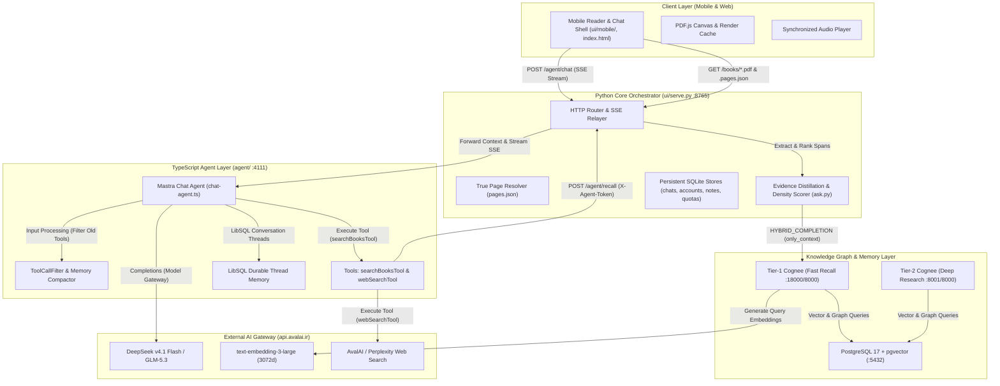
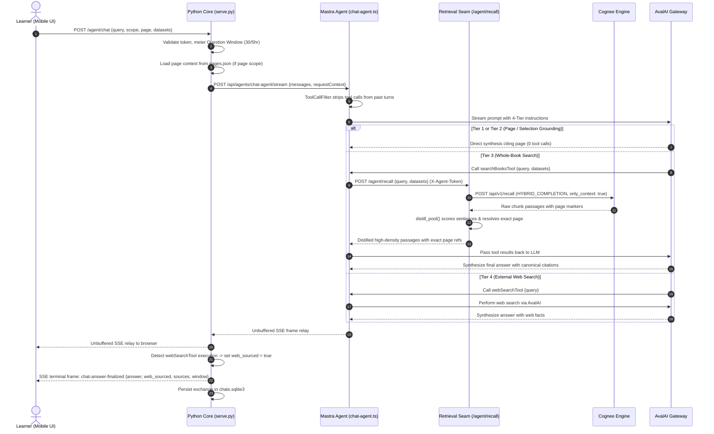

# Chat-With-Books (Fast-Book-Learning): Project Architecture & Technical Guide

---

## 1. Executive Summary & Project Purpose

**Chat-With-Books** (part of the `fast-book-learning` initiative) is a specialized Persian educational companion and intelligent book-learning platform. Designed for Persian-speaking learners seeking in-depth mastery of foundational texts, the platform allows users to read high-fidelity original book PDFs, ask deep thematic and contextual questions, take grounded notes, and listen to synchronized audio narration.

### Beachhead Book Collection
The platform operates over a curated, fixed collection of authoritative texts:
1. **طرح کلی اندیشۀ اسلامی در قرآن** (*The General Scheme of Islamic Thought in the Quran*) — Dataset identifier: `tarhe-kolli` (~862 pages, 243 indexed chunks).
2. **انسان ۲۵۰ ساله** (*The 250-Year-Old Human*) — Dataset identifier: `70143-336` (~376 pages, 98 indexed chunks).

### Core Architectural Promises
- **Verbatim Grounding & Zero Paraphrased Hallucination**: Quotes presented to the learner are machine-verified against the original text layer.
- **Canonical Interactive Citations**: Every citation adheres to `document <book> (page <N>)` or `document <book> (pages <N>-<M>)`. In the mobile reader, citations function as interactive buttons that jump directly to the exact page in the PDF canvas.
- **Platform-Guaranteed Boundary Markings**: External knowledge retrieved from the web is never disguised as book content. The platform guarantees a visible **«بیرون از کتاب»** (Outside the Book) badge and verified source links based strictly on tool execution records, not LLM self-reporting.

---

## 2. System Architecture

The system is built as a modular multi-service architecture coordinating TypeScript agent workflows, a Python orchestration and retrieval core, dual-tier Cognee memory engines, and a PostgreSQL storage layer.



---

## 3. Four-Tier Context Hierarchy (ADR-0023)

To ensure low latency, minimal token consumption, and precise grounding, the Mastra chat agent implements a strict **Four-Tier Context Hierarchy**:

| Tier | Name | Activation Trigger | Execution Mechanism | Latency / Cost |
| :--- | :--- | :--- | :--- | :--- |
| **Tier 1** | **In-Context Selection** | Learner selects text in the reader and taps *«پرسش از این متن»*. | Snippet is injected into prompt directives as closed-passage reading comprehension. **0 tool calls**. | Ultra-low (instant prompt synthesis, no vector search). |
| **Tier 2** | **Active Page Text Injection** | Scope toggle set to *«صفحه فعلی»* (Current Page). | Server extracts verbatim page text from `books/<dataset>.pages.json` (with $\pm 1$ boundary margins) into `requestContext.pageContext`. **0 tool calls**. | Fast (~1s TTFT, eliminates chunk splitting latency). |
| **Tier 3** | **Whole-Book Hybrid Search** | Scope toggle set to *«کل کتاب»* or active page lacks answer. | Agent executes `searchBooksTool`, calling Python `/agent/recall` -> Cognee hybrid retrieval -> extractive sentence distillation. | Moderate (~2-4s retrieval + synthesis). |
| **Tier 4** | **External Web Search Fallback** | Concepts or facts outside the Book collection. | Agent calls `webSearchTool` via AvalAI. Platform attaches **«بیرون از کتاب»** badge and verified links. | Higher (~3-5s web lookup + synthesis). |

> [!NOTE]
> If a learner asks a page-scoped question about a topic that does not exist on that page, the agent first politely acknowledges that the page does not cover the concept, and then automatically escalates to Tier 3 whole-book search.

---

## 4. End-to-End Query Lifecycle



---

## 5. Core Subsystems & Key Modules

### 5.1. The Mastra Agent Layer (`agent/src/mastra/`)
- **Agent Configuration (`agents/chat-agent.ts`)**:
  - Implements the conversational agent using `@mastra/core` and `@mastra/memory`.
  - Connects to AvalAI gateway using OpenAI-compatible endpoints with `deepseek-v4.1-flash`.
- **Memory History Pruning (`ToolCallFilter`)**:
  - Automatically compacts past turns by stripping verbose `searchBooksTool` and `webSearchTool` execution payloads.
  - Maintains clean `user <-> assistant` alternation while preserving all assistant syntheses and canonical citations.
  - Reduces 6-turn prompt tokens from >30,000 down to <12,000 (>60% reduction), eliminating latency accumulation.
- **Dynamic Cognitive Scaffolding (`buildPersonalizedDirectives`)**:
  - Adapts tone dynamically based on user profile: Professional (حرفه‌ای), Educational (آموزشی), Youth/Children (کودک و نوجوان), or Simple (ساده و روان).
  - Scaffolds explanations according to learner age (<15 years, 15-22 years, 22+ years) and knowledge level (مقدماتی, متوسط, پیشرفته).

### 5.2. Retrieval & Sentence Distillation Seam (`ui/ask.py` & `ui/serve.py`)
- **Seam Endpoint (`POST /agent/recall`)**:
  - Protected by a shared HMAC secret header `X-Agent-Token`.
  - Proxies to Cognee's `HYBRID_COMPLETION` with `only_context: true` (no LLM synthesis on Cognee's side).
- **Extractive Distillation (`distill_pool`)**:
  - Splits retrieved text into grammatical Farsi sentences.
  - Computes query keyword density and token overlap.
  - Extracts 1–3 contiguous sentences surrounding peak scores up to a character budget (e.g. 400–600 chars).
  - Sharpens coarse multi-page chunks (e.g. `pages 707-712`) into exact single-page provenance (`page 709`).
  - Employs an in-memory TTL recall cache to eliminate redundant database and embedding hits.

### 5.3. Mobile Reader & Provenance Engine (`ui/mobile/` & `ui/book-reader/`)
- **PDF Viewing**: Powered by vendored PDF.js rendering original book PDFs with a server-side pre-rendered raster disk cache (`render-cache`) to ensure instant page flips.
- **Interactive Citation Resolution**:
  - Text citations formatted as `document <book> (page <N>)` are detected by client-side regex.
  - Clicking a citation navigates the reader canvas directly to that page, highlights the target text, and updates the URL hash.
- **Synchronized Audio Narration (`fast-book-audio-delivery`, `ui/narration.py`)**:
  - Delivers high-quality chapter lecture audio and TTS.
  - Utilizes a quantized ONNX forced-alignment model (`models/alignment/model_quantized.onnx`) to highlight words and sentences in sync with audio playback.

### 5.4. Accounts, Quotas & Metering
- **Stateless HMAC Authentication (`accounts.py`)**:
  - Admin-issued accounts (email/password hashed with PBKDF2-SHA256, 240k iterations).
  - Signed HTTP-only cookies (`cwb_auth`).
- **Question Window (`question_window.py`)**:
  - Meters chat interactions at **30 Questions per 5 hours** per account.
  - Completion-anchored: only fully completed, non-aborted answers deduct from the window.
  - PDF reading, notes, and audio playback are completely unmetered.

---

## 6. Data Storage & Schema Map

| Store | Technology | Path / Location | Purpose |
| :--- | :--- | :--- | :--- |
| **Vector & Graph Memory** | PostgreSQL 17 + pgvector | Docker `chat-with-books-postgres:5432` | Relational metadata, 3072-dimensional text embeddings (`text-embedding-3-large`), and entity graphs. |
| **Agent Threads** | LibSQL / SQLite | `agent_data:/data/mastra.sqlite` | Multi-turn conversation thread state and memory checkpoints for the Mastra agent. |
| **Chat Exchanges** | SQLite3 | `session_quota:/data/chats.sqlite3` | Persisted learner dialogue history, verified citations, and web source provenance records. |
| **Accounts & Balances** | SQLite3 | `session_quota:/data/accounts.sqlite3` | User credentials, roles, profile preferences, and credit balances. |
| **Usage & Audit Logs** | SQLite3 | `session_quota:/data/usage.sqlite3`, `audit.sqlite3` | Question window timestamps, token metrics, and admin operations. |
| **Notebooks** | SQLite3 | `session_quota:/data/notes.sqlite3` | Highlights, bookmarks, and reader notes taken by learners. |
| **Book Assets** | Static Files | `./books/` (`.pdf`, `.pages.json`) | Read-only book binaries and per-page pre-indexed text representations. |

---

## 7. Configuration & Environment Reference

Key environment variables configured in `.env` and `compose.yaml`:

```ini
# Model Gateway & API Keys
LLM_ENDPOINT=https://api.avalai.ir/v1
LLM_API_KEY=your_avalai_api_key
CHAT_AGENT_MODEL=avalai/deepseek-v4.1-flash
EMBEDDING_MODEL=text-embedding-3-large
EMBEDDING_DIMENSIONS=3072

# Service URLs & Internal Communication
AGENT_URL=http://chat-with-books-agent:4111
PYTHON_CORE_URL=http://session:8765
COGNEE_URL=http://chat-with-books-cognee:8000
NEXT_TIER_URL=http://chat-with-books-cognee-next-tier:8000
AGENT_SERVICE_TOKEN=your_internal_shared_token
AUTH_SECRET=your_jwt_cookie_signing_secret

# Admin Account Bootstrap
ADMIN_EMAIL=admin@example.com
ADMIN_PASSWORD=secure_admin_password
```

---

## 8. Development & Verification Guide

### Starting the Stack
```powershell
# 1. Start core memory and database services
docker compose up -d postgres cognee cognee-next-tier

# 2. Start Mastra agent and Python session services
docker compose --profile session up -d --build

# 3. Verify health of services
curl http://localhost:8765/livez       # Python Session Core
curl http://localhost:4111/health      # Mastra Chat Agent
curl http://localhost:18000/health     # Primary Cognee Engine
```

### Running Test Suites
```powershell
# Run Python backend unit and contract tests
pytest tests/test_agent_chat.py tests/test_evidence_distillation.py tests/test_agent_recall.py -v

# Run TypeScript Mastra agent tests & multi-turn benchmark
cd agent
npm run test
```
