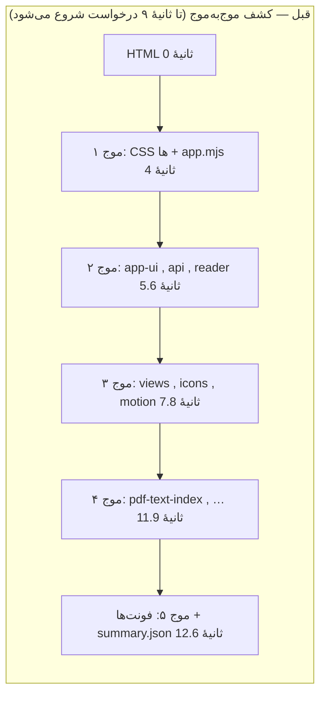
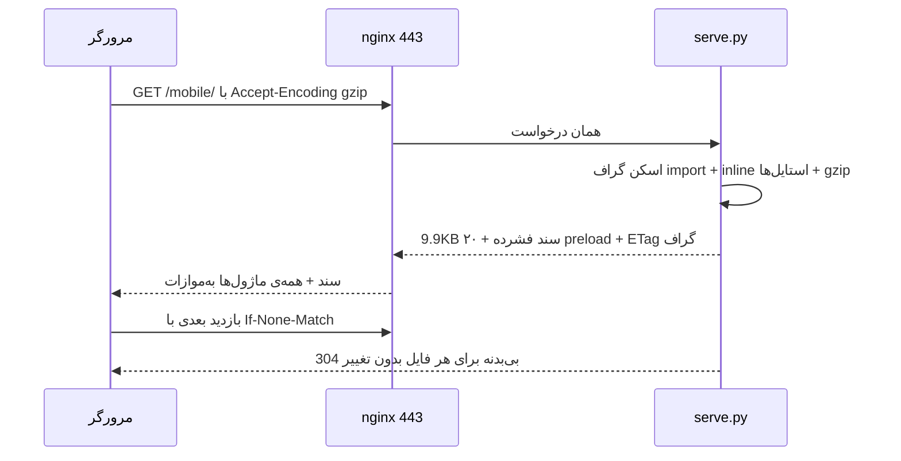
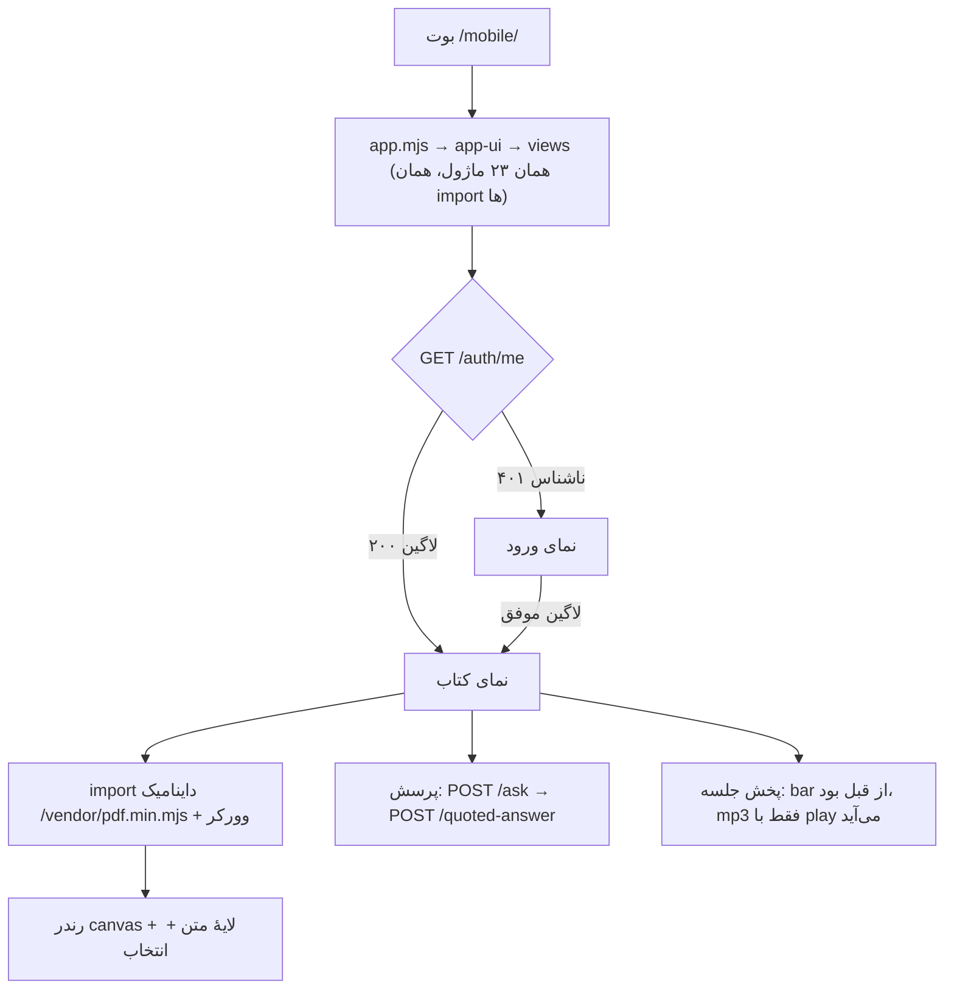
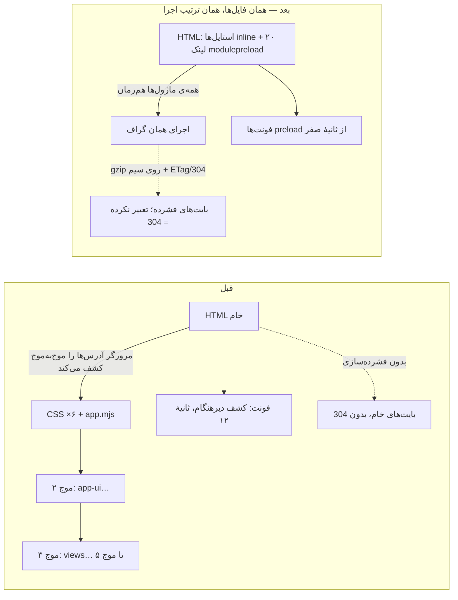
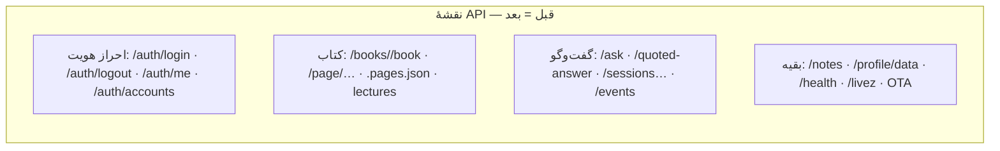

# کاراییِ چهرهٔ موبایل — صفر تا صد

> سند جامع کارایی `/mobile/`: اندازه‌گیری، علت‌یابی، اصلاح‌ها، دفتر ثبتِ نگه‌داشته‌ها و برگردانده‌ها، و نگهبانی.
> همه‌ی اعداد واقعی‌اند — از نشست ۲۰۲۶-۱۰-۲۳/۲۴ و کامیت‌های `c32dd61` و `9f4db68` — و دستور بازتولید هر عدد همین‌جاست.
> قانون حاکم بر کل کار (skill `performance-optimization`): **بدون اندازه‌گیری، هیچ تغییری نگه داشته نمی‌شود؛ «بی‌اثر» یعنی برگرداندن.**

---

## فهرست

1. [مسئله — گزارشی با نمرهٔ ۳۰](#۱-مسئله--گزارشی-با-نمرهٔ-۳۰)
2. [قدم اول: اندازه‌گیریِ تمیز](#۲-قدم-اول-اندازه‌گیری-تمیز)
3. [علت‌یابی — پنج موجِ کشفِ ماژول](#۳-علت-یابی--پنج-موج-کشف-ماژول)
4. [اصلاح‌های دور اول](#۴-اصلاح-های-دور-اول)
5. [اصلاح‌های دور دوم — و بازگشتی که تقریباً رسوب کرد](#۵-اصلاح-های-دور-دوم--و-بازگشتی-که-تقریباً-رسوب-کرد)
6. [فونت — سبک‌سازی وزیرمتن](#۶-فونت--سبک-سازی-وزیرمتن)
7. [دفتر ثبت](#۷-دفتر-ثبت)
8. [نگهبانی — تست‌ها و دستور اندازه‌گیری](#۸-نگهبانی--تست-ها-و-دستور-اندازه-گیری)
9. [وضعیت پروداکشن و مسیر انتشار](#۹-وضعیت-پروداکشن-و-مسیر-انتشار)

---

## ۱. مسئله — گزارشی با نمرهٔ ۳۰

گزارش Lighthouse اپراتور روی `https://booksai.rayesh-team.ir/mobile/`:

| متریک | مقدار | آستانهٔ خوب |
|---|---|---|
| Performance | **۳۰** | ۹۰+ |
| FCP | ۳٫۹s | ≤1.8s |
| LCP | ۶٫۳s | ≤2.5s |
| TBT | **۴,۳۹۰ms** | ≤200ms |
| Speed Index | **۲۵٫۳s** | ≤3.4s |
| «JS استفاده‌نشده» | ~۷,۹۸۹KiB | — |
| «CSS استفاده‌نشده» | ~۱,۶۳۲KiB | — |

خود Lighthouse هم هشدارش را داده بود: *«افزونه‌های کروم روی این اجرا اثر منفی گذاشتند»*. این جمله کلید قدم بعدی بود.

## ۲. قدم اول: اندازه‌گیریِ تمیز

هیچ تصمیمی روی گزارش آلوده گرفته نمی‌شود. دوباره اجرا — همان صفحه، کرومِ headless بدون افزونه و بدون نشست لاگین:

```
npx lighthouse https://booksai.rayesh-team.ir/mobile/ \
  --only-categories=performance --chrome-flags="--headless=new"
```

نتیجه: **نمرهٔ واقعی ۸۰ بود، نه ۳۰؛ کل دانلود ۳۹۵KB بود، نه ~۸MB.** آن ۸ مگابایتِ «JS استفاده‌نشده» و TBT چهارثانیه‌ای، عمدتاً اثر (۱) افزونه‌های کروم و (۲) نشستِ لاگین‌شدهٔ اپراتور بود که PDF.js (۱٫۷MB) و فایل کتاب را هم به بوت می‌کشید. **درس: گزارش Lighthouse شخصی همیشه در حالت ناشناس/بدون افزونه گرفته شود.**

اما نمرهٔ ۸۰ هم واقعی نبود که بماند — واترفال درخواست‌ها مشکل ساختاری را لو می‌داد:

- هر درخواست استاتیک روی مسیر پروداکشن **~۱٫۲ تا ۲ ثانیه** تأخیر داشت (اندازه‌گیری با curl روی اتصال گرم؛ خود serve.py لوکال ۱–۲ms جواب می‌دهد — تأخیر **محیطی** است، از مسیر شبکه تا سرور)
- **فونت‌ها تا ثانیهٔ ۱۲٫۶ می‌رسیدند** (دیر کشف می‌شدند)
- **mp3 جلسهٔ اول (۶۴KB) وسط بوتِ کاربر ناشناس** دانلود می‌شد (`preload='metadata'`)
- هیچ فشرده‌سازی‌ای روی سیم نبود؛ نه gzip، نه 304 — هر بار تغییر کوچک، کل فایل دوباره

## ۳. علت‌یابی — پنج موجِ کشفِ ماژول

صفحه ۲۳ ماژول ES دارد که import هایشان زنجیره‌ای است. مرورگر آدرس هر موج را فقط **بعد از** دانلود موج قبل می‌فهمد. واترفال ثبت‌شده (همان اجرای تمیز):



پنج موجِ سریال × ~۱٫۲ ثانیه تأخیرِ هر درخواست = Speed Index ‏۱۸–۲۵ ثانیه. این، و فقط این، قاتل اصلی بود — نه حجم (کل صفحه ~۴۰KB gzip‌نشده بود)، نه CPU (main-thread لوکال ۳۷۰ms).

## ۴. اصلاح‌های دور اول

### ۴.۱ فشرده‌سازی و اعتبارسنجی استاتیک‌ها (`_serve_static` در `serve.py`)

الگوی مسیر Book (ADR-0017) برای استاتیک‌های UI تکرار شد: gzip وقتی کلاینت می‌پذیرد (کش بر اساس mtime)، **ETag + 304** برای همه، `Cache-Control: no-cache` قبلی به `max-age=0, must-revalidate` تبدیل شد — قانون صفحهٔ تازه (حادثهٔ ۲۰۲۶-۰۹-۱۱) حفظ شد: استایل/ماژول تغییر کند، بار بعدی invalidate می‌شود؛ تغییر نکند، فقط یک `stat` و پاسخ بی‌بدنه.

### ۴.۲ تزریق `modulepreload` در صفحه (`_mobile_page`)

سرور Closure استاتیک import های خود صفحه را از روی دیسک اسکن می‌کند و **۲۰ لینک `modulepreload`** را داخل HTML تزریق می‌کند — مرورگر همه‌ی آدرس‌ها را همان لحظهٔ parse می‌داند و همه با هم می‌روند. import های داینامیک (`/vendor/pdf.min.mjs`) عمداً خارج مجموعه می‌مانند: موتور PDF فقط با باز شدن کتاب لود می‌شود، نه بوتِ کاربر ناشناس. ETag صفحه هم mtime کل گراف را پوشش می‌دهد: ۳۰۴ یعنی «کل باندل تغییری نکرده».

### ۴.۳ بقیهٔ اصلاح‌ها

- `<link rel="preload" as="font">` برای دو وزن وزیرمتن + متا description (همان جلسه SEO هم اصلاح شد)
- `lecture-player`: `preload='none'` — mp3 فقط با فشردن پخش
- `ops/nginx/booksai.conf`: فعال‌سازی gzip (کمربندِ زیر gzip پایتون) + **HTTP/2** (تا آن روز فقط http/1.1 بود و ۳۱ درخواست روی ۶ اتصال صف می‌شدند) — نصب‌اش با اجرای دستی ورک‌فلو `fix-tls` روی سرور می‌نشیند

### نتیجهٔ دور اول (میانهٔ ۳ اجرا، لوکال با throttle استاندارد)

| | قبل | بعد |
|---|---|---|
| نمره | ۹۰ | **۹۷** |
| FCP | 2.4s | **1.7s** |
| LCP | 3.2s | **2.4s** |
| انتقال | ۳۳۲KB | **۱۸۴KB** |

و در شبیه‌سازی وفادار به مسیر پروداکشن (`--throttling.request-latency-ms=1000`): شروع درخواست‌ها از **۸ موج تا ثانیهٔ ۹ → همه در ثانیهٔ اول**.

## ۵. اصلاح‌های دور دوم — و بازگشتی که تقریباً رسوب کرد

دیاگنوستیک دور دوم گفت تنها FAIL باقی‌مانده **۶ فایل CSS رندر-بلاک** است (~۳۰۰ms هرکدام تحت throttle). ایده: inline کردن CSS داخل HTML (همان الگوی تزریق preload).

**اولین پیاده‌سازی، اندازه‌گیری شد و بدتر بود:** انتقال ۱۸۴→۲۱۱KB و FCP ‏+0.1s — چون HTMLِ حامل ۴۳٫۷KB استایل، **بدون gzip** می‌رفت. همان‌جا معلوم شد سندِ تزریقی هم باید فشرده شود؛ با gzip سند (۴۳٫۷→۹٫۹KB)، تغییر به برد تبدیل شد:

| | دور اول | فقط inline | inline + gzip سند |
|---|---|---|---|
| انتقال | ۱۸۴KB | **۲۱۱KB ✗** | **۱۷۸KB ✓** |
| FCP | 1.8s | 1.9s ✗ | **1.7s ✓** |
| LCP | 2.6s | 2.6s | **2.2s ✓** |
| رندر-بلاک | ۶ آیتم | ۰ | **۰** |
| درخواست‌ها | ۳۵ | ۲۹ | **۲۹** |

این جدول مهم‌ترین درس کل سند است: **بدون A/B، یک regression با لباس بهینه‌سازی کامیون می‌شد.** فایل‌های CSS روی دیسک منبع حقیقت می‌مانند — فقط شکل سیم عوض می‌شود — و ETag صفحه mtime استایل‌شیت‌ها را هم پوشش می‌دهد.

## ۶. فونت — سبک‌سازی وزیرمتن

فونت‌ها ۱۰۰KB از ۱۷۸KB انتقال بودند (Regular + Bold هرکدام ~۵۰KB). وزیرمتن آپ‌استریم کل پوشش چندخطی‌اش را دارد؛ UI فقط فارسی + لاتین پایه می‌کشد:

```bash
py -m fontTools.subset Vazirmatn-Regular.woff2 --output-file=… --flavor=woff2 \
  --layout-features='*' \
  --unicodes="U+0020-007E,U+00A0-00FF,U+0600-06FF,U+2000-206F,U+FB50-FDFF,U+FE70-FEFF"
```

- ۵۰٫۷KB → **۳۳٫۹KB** (Bold: ۵۱KB → ۳۴٫۴KB). `tools/subset_vazirmatn.py` بازتولید می‌کند (همیشه از فونت آپ‌استریم، نه نسخهٔ subset‌شده)
- **صحت رندر برنامه‌ای اثبات شد**: هر ۱۷۲ کاراکتر متن UI (فارسی/لاتین/نمادها) با cmap فونت subset چک شد؛ ۳ نمادی که «غایب» دیده شد (↗ ▶ ❚) در فونت اصلی هم هرگز نبوده‌اند — مرورگر همان‌طور که قبل از تغییر fallback می‌گرفت، می‌گیرد
- shaping کامل حفظ شد (`--layout-features='*'`): فرم‌های زمینه‌ای فارسی از GSUB می‌آیند، نه کدپوینت

## ۷. دفتر ثبت

قانون: هر ایده — نگه‌داشته و برگردانده — ثبت می‌شود تا ide مرده، ربع بعدی دوباره اجرا نشود.

| ایده | خط پایه → نتیجه | رأی | چرا |
|---|---|---|---|
| gzip + ETag/304 استاتیک‌ها | ۳۳۲→۱۸۴KB | **نگه** | ۷۰٪ کاهش سیم + بازدید تکراری تقریباً رایگان |
| تزریق modulepreload | موج‌های ۸→۳ (تأخیر ۱s) | **نگه** | حذف آبشار کشف؛ تنها ضربه به تأخیر محیطی |
| preload دو فونت | فونت 12.6s → همراه CSS | **نگه** | LCP متنی از فونت منتظر بود |
| `preload='none'` برای mp3 | ‎−۶۴KB از بوت ناشناس | **نگه** | پخش که رسید دانلود می‌رسد |
| nginx: gzip + HTTP/2 | — | **نگه (کانفیگ)** | نصب با fix-tls روی سرور؛ سقف واقعیِ تأخیر محیطی |
| **inline CSS بدون gzip** | ۱۸۴→**۲۱۱KB**، FCP ‏+0.1s | **برگشت** | سند خام ۴۳٫۷KB؛ با gzip به برد تبدیل شد (§۵) |
| inline CSS **با** gzip سند | ۱۷۸KB، LCP ‏−0.3s، رندر-بلاک ۰ | **نگه** | تنها FAIL باقی‌مانده صفر شد |
| subset وزیرمتن | ۱۷۸→۱۴۶KB | **نگه** | ۱۹٪ کمتر؛ پوشش cmap اثبات شد |
| باندل ۲۳ ماژول در یک فایل | — | **اجرانی‌شد** | به build-step نیاز دارد؛ ضد فلسفه no-build این ریپو؛ با preload فقط ۲ موج است |
| حذف preload وزن Bold | — | **رد** | هر دو وزن بالای صفحه‌اند |
| Brotli در nginx | — | **رد (فعلاً)** | ماژول nginx روی سرور نصب نیست |
| HTTP/2 Push | — | **رد** | منسوخ‌شده؛ جایش preload تزریقی |

## ۸. نگهبانی — تست‌ها و دستور اندازه‌گیری

### تست‌های گاری (`tests/test_static_delivery.py`)

رفتارهایی که regression‌شان بی‌صدا هزینه می‌دهد، pin شده‌اند: gzip + `Vary`، جفت ETag/304، استایل‌های inline (۶ عدد، بدون `rel="stylesheet"`)، سند gzip‌شده، گراف preload (شامل ماژول‌ها، **غیر**شامل PDF.js)، و تست node برای `preload='none'` پخش‌کننده.

### دستور اندازه‌گیری (عیناً همین اجرا شود)

```bash
# سرور لوکال (پس‌زمینه، نه & داخل دستور مرکب — روی ویندوز یتیم می‌شود)
NO_PROXY=127.0.0.1,localhost SESSION_UI_PORT=8765 .venv/Scripts/python.exe ui/serve.py

# سه اجرا، میانه ملاک است (نویزِ مشاهده‌شده: LCP ±0.1s، انتقال قطعی)
npx lighthouse http://127.0.0.1:8765/mobile/ --only-categories=performance \
  --chrome-flags="--headless=new --no-sandbox --proxy-server=direct://"

# شبیه‌سازی مسیر پروداکشن (تأخیر ~1s هر درخواست؛ پرنویز — فقط میانه)
--throttling-method=devtools --throttling.request-latency-ms=1000 --throttling.cpu-slowdown-multiplier=4
```

### عدد نهایی لوکال

| متریک | اولین گزارش | پایان دور ۱ | پایان دور ۲ |
|---|---|---|---|
| نمره | ~۹۰ لوکال / ۸۰ پروداکشن | ۹۷ | **۹۸** |
| FCP | 2.4s | 1.7s | **1.7s** |
| LCP | 3.2s | 2.4s | **2.2s** |
| Speed Index | 2.4s | 1.7s | **1.7s** |
| TBT | 0 | 0 | **0** |
| درخواست‌ها | ۳۶ | ۳۵ | **۲۹** |
| انتقال | ۳۳۲KB | ۱۸۴KB | **۱۴۶KB** |

## ۹. وضعیت پروداکشن و مسیر انتشار



- پروداکشن (بعد از deploy `c32dd61`) راستی‌آزمایی شد: سند **۹,۸۵۴ بایت gzip‌شده**، ۶ استایل inline، ۲۰ preload؛ مسیر `/auth/otp/*` هم سالم
- **آنچه روی پروداکشن هنوز ننشسته:** gzip و HTTP/2 در nginx — با اجرای دستی ورک‌فلو `fix-tls` نصب می‌شود (خودش با `nginx -t` گیت می‌زند). تا آن لحظه، فشرده‌سازی را serve.py انجام می‌دهد ولی multiplexing نداریم و ~۱٫۲s تأخیرِ هر درخواست روی http/1.1 باقی است
- تأخیر ~۱٫۲ ثانیه‌ای هر درخواست **محیطی** است (مسیر ایران‌تاسرور)؛ کد کاری با آن نمی‌تواند بکند جز کم‌کردن تعداد و حجم — که شد

---

## ۱۰. چه چیزی تغییر نکرد — پاسخ صریح به سه سؤال

سه سؤال مکرر دربارهٔ این کار: **الگوریتمی عوض شد؟ فلوی حذف شد؟ API‌ای پاک شد؟** هر سه: **نه.** کل کار در لایهٔ انتقال (شکلِ سیم) بود؛ منطق اجرا، گراف ماژول‌ها و نقشهٔ API یک‌خط تغییر نکرد.

### ۱۰.۱ جریان اجرای اپ — قبل و بعد یکسان



تنها تفاوت رفتاریِ قابل‌مشاهده در کل کار همین یک مورد است (§۴.۳): mp3 جلسهٔ اول قبلاً وسط بوتِ کاربرِ ناشناس دانلود می‌شد (`preload='metadata'`)، حالا با فشردن «پخش» (`preload='none'`). پخش، جابه‌جایی، «بدون مقدمه» — همه همان.

### ۱۰.۲ آنچه عوض شد — شکل سیم، نه جعبه‌ها



جانِ کلام: مرورگر **همان فایل‌ها** را می‌گیرد، **همان ترتیبِ اجرا** را دارد، **همان DOM** را می‌سازد — فقط زودتر و فشرده‌تر. فایل‌های CSS و ماژول‌ها روی دیسک دست‌نخورده‌اند؛ `_mobile_page` هنگام سرو، شکل سیم را عوض می‌کند.

### ۱۰.۳ نقشهٔ API — یک مسیر هم حذف یا تغییر نکرد



(مسیرهای `/auth/otp/request`، `/auth/otp/verify` و `/waitlist` **اضافه** شدند — افزوده، نه جایگزین؛ بخش پیامک، نه بخش کارایی.)

| سؤال | پاسخ | توضیح |
|---|---|---|
| الگوریتمی عوض شد؟ | **نه** | هیچ تابع منطقی (بازنویسی نمره، کامپوزر، گیت‌ها، PDF رندر…) تغییر نکرد — فقط لایهٔ سرو استاتیک در `serve.py` اضافه شد |
| فلوی حذف شد؟ | **نه** | هر گرافی که بود، هست؛ تنها استثنا: دانلود mp3 از «ابتدای بوت» به «لحظهٔ پخش» منتقل شد (رفتار پخش همان است) |
| API پاک شد؟ | **نه** | صفر حذف/تغییر؛ سه مسیر OTP همزمان **افزوده** شدند |
