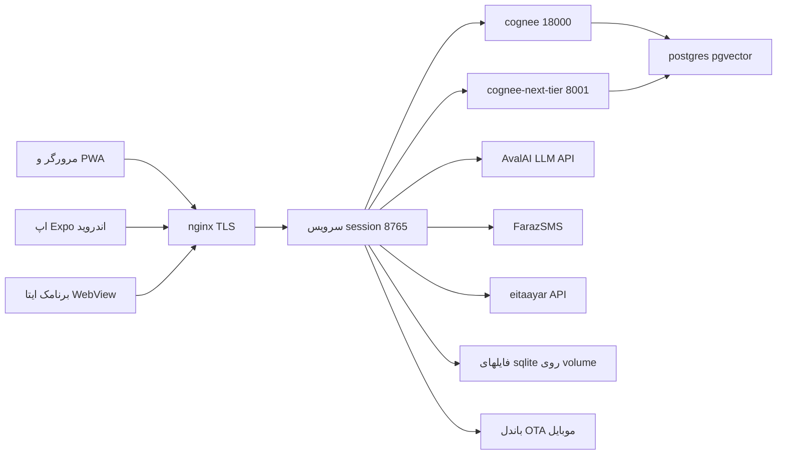

# مدل تهدید و گزارش بررسی امنیتی — chat-with-books (fast-book-learning)

تاریخ: 2026-10-24 · شاخه: `2book-ingest` · بازبینی ایستا (static review) — بدون تست نفوذ زنده روی VPS
حوزه: کل پلتفرم — سرور session (ui/)، برنامک ایتا، اپ موبایل/PWA، استقرار (compose/nginx)، CI، تاریخچه‌ی گیت، وابستگی‌ها

---

## Executive summary

پلتفرم از نظر اصول پایه‌ی امنیتی در وضعیت خوبی است: احراز هویت با PBKDF2-240k و مقایسه‌ی constant-time، کوکی HttpOnly + SameSite=Lax، توکن امضاشده‌ی HMAC با منقضی‌شدن داخل payload، همه‌ی کوئری‌ها پارامتری، رندر HTML سرور و کلاینت به‌طور سیستماتیک escape می‌شود، مسیرهای فایل با allowlist محافظت می‌شوند، SSRF نداریم (هیچ URL سمت‌سرورِ کنترل‌شده توسط کاربر وجود ندارد)، خروجی LLM هرگز اجرا نمی‌شود و نقل‌قول‌ها با گارد واژه‌به‌واژه در برابر متن واقعی کتاب راستی‌آزمایی می‌شوند (`ui/guard.py`)، استقرار production همه‌ی پورت‌ها را روی 127.0.0.1 قفل کرده و سیکرت‌ها هیچ‌وقت به گیت راه نیافته‌اند.

**بزرگ‌ترین یافته:** کل محتوای کتاب‌ها — PDF ها، متن کامل صفحات (`.pages.json`)، رستر صفحات و صدای جلسات — **بدون هیچ احراز هویتی** از اینترنت قابل دانلود است (F-001). یافته‌های بعدی به‌ترتیب: نبود rate-limit روی `/auth/login` (F-002)، اوراکل «این شماره حساب دارد؟» در `/auth/otp/request` (F-003)، غیبت هدرهای امنیتی و فلگ `Secure` کوکی (F-004/F-005)، و یک PDF کتاب در تاریخچه‌ی گیت (F-006). هیچ یافته‌ی بحرانیِ «کنترل کامل سرور» (RCE پیش از احراز هویت، دورزدن احراز هویت، SQLi) پیدا نشد.

## Scope و فرض‌ها

**در حوزه:** `ui/` (سرور + کلاینت‌ها)، `ops/nginx/`، `compose*.yaml`، `scripts/`، `.github/workflows/`، `docs/`، تاریخچه‌ی کامل گیت (262 کامیت)، `mobile/` و `ui/narration/` (وابستگی‌های npm)، `ui/Dockerfile`.
**خارج از حوزه:** کد داخل ایمیج `cognee/cognee:main` (پروژه‌ی ثالث — فقط پیکربندیِ نحوه‌ی سرو‌شدنش بررسی شد)، دستگاه‌های کاربران، زیرساخت GitLab، VPS به‌صورت زنده.

**فرض‌های تعیین‌کننده‌ی اولویت (اگر غلط باشند، رتبه عوض می‌شود):**
1. VPS واحد؛ nginx تنها ورودی اینترنت است؛ سرویس‌های دیگر فقط 127.0.0.1 (`compose.production.yaml`).
2. تعداد حساب‌ها کم است (پایلوت B2B) و ادمین همان PM است.
3. مسیرهای عمومی کتاب (F-001) شاید یک انتخاب محصولی باشند؛ اگر عمدی است، شدت آن «پذیرفته‌شده با ریسک تجاری» می‌شود نه «باگ».
4. اپراتورهای نشست (کاربران ثبت‌نام‌شده) مدل تهدید داخلی محسوب می‌شوند؛ بررسی IDOR روی همه‌ی مسیرهای خواندن/نوشتن انجام شد.

**پرسش‌های باز:** (۱) آیا عمومی‌بودن مسیر `/books/...` عمدی است؟ (۲) آیا `AUTH_SECRET` روی VPS مقدار ثابت دارد؟ (تولید per-process باعث خروج همه با هر ری‌استارت می‌شود — خودش هشدار می‌دهد.) (۳) آیا دایرکتوری بکاپ محلی (`D:\code\CHATBOT\backups`) رمزنگاری‌شده است؟ آرشیو بکاپ، `.env` کامل و هش رمزها را حمل می‌کند.

## System model

### اجزا و مرزهای اعتماد

- **اینترنت → nginx → session (8765):** TLS-Let's Encrypt (`ops/nginx/booksai.conf`)، پروکسی بی‌قیدِ همه‌ی مسیرها به 8765. کنترل احراز/نرخ، تماماً در خود serve.py است — nginx هیچ rate-limit یا هدر امنیتی اضافه نمی‌کند.
- **session → cognee / next-tier:** فقط مسیرهای allowlist (`ALLOWED_PROXY = {"/health", "/api/v1/recall"}`, serve.py:460) و body بازاعتبارسنجی‌شده (`_validated_recall_body`, serve.py:3773). datasets با `validated_datasets` (serve.py:855) به مجموعه‌ی کتاب محدود می‌شود.
- **session → AvalAI / FarazSMS / eitaayar:** خروجی، با کلیدهای env؛ هیچ URL ورودی از کاربر نیست → SSRF نداریم.
- **کاربرِ واردشده → استورهای sqlite:** همه‌ی خواندن/نوشتن‌ها با `account` (ایمیلِ مشتق از توکن امضاشده) کلید می‌خورند، نه با id کلاینت — سطح IDOR بسته است.
- **browser ← خروجی LLM:** هرگز اجرا نمی‌شود؛ فقط به‌صورت متنِ escape‌شده رندر می‌شود؛ نقل‌قول‌ها باید واژه‌به‌واژه با متن کتاب مچ شوند (guard) وگرنه رد می‌شوند.
- **CI → VPS:** workflow_dispatch دستی با کلید SSH از secrets؛ جاب intake با کانتینر `--privileged --pid=host` (معادل root — پذیرفته‌شده، اما کلیدِ GH را معادل root کرده).

### دارایی‌ها

| دارایی | چرا مهم است | هدف (C/I/A) |
|---|---|---|
| PDFها و متن کامل کتاب‌ها (مشتری B2B) | دارایی اصلی محصول؛ حق نشر مشتری | C |
| `.env` (کلیدهای AvalAI/Z.AI/FarazSMS، توکن ایتا، AUTH_SECRET، ADMIN_PASSWORD) | هزینه‌ی مالی، ربایش حساب، امضای توکن | C/I |
| استورهای sqlite (/data: حساب‌ها، تراکنش، پژوهش، نشست‌ها، waitlist) | هش رمز، تلفن‌ها، اعتبار تومانی | C/I |
| توکن ایتا | هم کلید امضای initData، هم کلید پیام‌دهی | C/I |
| Balance کاربران | پول پیش‌پرداخت | I |
| دفتر رخدادها (audit) | اعتبار حقوقی کنش‌های ادمین | I |

### مدل مهاجم

**توانایی‌ها:** هر کسی روی اینترنت (اسکنر خودکار)، کاربر ثبت‌نام‌شده‌ی بدخواه با حساب معتبر، دارنده‌ی شماره‌ی موبایلِ شخص ثالث (برای OTP و اوراکل‌ها).
**عدم‌توانایی‌ها (برای جلوگیری از بزرگ‌نمایی شدت):** دسترسی فیزیکی/SSH به VPS، خواندن memory سرور، کنترل دامنه/گواهی، دسترسی به حساب GitLab یا secrets گیتهاب.

## Entry points

| سطح | نحوه‌ی دسترسی | احراز هویت | شواهد |
|---|---|---|---|
| Sheet PWA (`/`)، اپ موبایل (`/mobile/`) | HTTPS | کوکی/Bearer برای API؛ صفحات عمومی | serve.py:1110 |
| API نشست‌ها/یادداشت‌ها/پژوهش | HTTPS | resolve_identity — همه account-keyed | serve.py:3274–3475 |
| `/auth/login`، `/auth/otp/*`، `/waitlist` | HTTPS، ناشناس | — (خودِ درِ ورود) | serve.py:2364–2384 |
| `/eitaa/auth`، `/eitaa/link`، `/eitaa/unlink` | HTTPS | امضای HMAC initData + پنجره‌ی ۱ ساعته | ui/eitaa.py:90 |
| `/books/**` (PDF، pages.json، page PNG، lectures، خلاصه) | HTTPS | **هیچ** | serve.py:1212–1220 |
| `/ota`، `/ota/current/**` | HTTPS | هیچ (طراحی‌شده) | serve.py:2027 |
| `/admin`، `/admin/*` | HTTPS | resolve_account + role==admin + audit | serve.py:3015، 3125 |
| `/api/v1/recall` (پروکسی cognee) | HTTPS | _gate_account (توکن + Balance + سهمیه) | serve.py:2435 |
| `/books/<doc>/narration` | HTTPS | resolve_identity + سقف ۳۰۰KB | serve.py:2553 |
| `/events` (SSE) | HTTPS | resolve_identity؛ فقط رخدادهای خود حساب | serve.py:2078 |
| `/health` (پروکسی به cognee) | HTTPS | هیچ | serve.py:1159 |

## یافته‌ها (به‌ترتیب شدت)

### F-001 · HIGH — کل کتابخانه بدون احراز هویت عمومی است
- **شواهد:** در `do_GET` (serve.py:1140–1220) مسیرهای `_book_file` (PDF و `.pages.json` — متن کامل کتاب)، `_book_page_image` (رستر صفحات)، `_lecture_audio` (MP3 جلسات) و `_lectures_summary` هیچ `resolve_identity`ای ندارند؛ nginx همه‌چیز را پروکسی می‌کند (`ops/nginx/booksai.conf`). در نقطه‌ی مقابل، مسیر narration همان فایل‌ها احراز دارد (serve.py:2555) — پس لایه‌ی auth برای بقیه «جا افتاده» به نظر می‌رسد.
- **اثر:** هر فردی بدون حساب و بدون پرداخت، `https://…/books/tarhe-kolli.pdf`، متن کامل هر دو کتاب و صدای جلسات را دانلود می‌کند. دورزدن کامل مدل درآمدیِ «پرسش پولی، خواندن رایگان در reader» و افشای محتوای دارای حق نشر مشتری.
- **توصیه:** اگر reader برای عموم باز است، این یک تصمیم محصولی ثبت‌شده نیست — gate با `resolve_identity` اضافه شود (کلاینت‌ها از قبل توکن می‌فرستند؛ pdf.js Range requests هم هدر را می‌برند). حداقلِ حالت باز: rate-limit در nginx + `noindex`.

### F-002 · MEDIUM — `/auth/login` بدون rate-limit و بدون lockout
- **شواهد:** `_auth_login` (serve.py:2120) فقط 401 می‌دهد؛ `accounts.py` docstring صراحتاً lockout را حذف می‌کند (خط 14–17)؛ nginx هم rate-limit ندارد.
- **اثر:** brute-force آنلاین ممکن است؛ هر تلاش یک PBKDF2-240k کامل است (≈100–200ms CPU) → هم فرصت حدس برای گذرواژه‌های ضعیفِ Admin-issued، هم ارزان‌ترین DoSِ CPU روی کل سرور (ThreadingHTTPServer، هر درخواست یک thread).
- **توصیه:** rate-limit per-IP روی `/auth/login` و `/auth/otp/*` (در همین حافظه‌ی in-process کافی است — تک‌پروسسه است؛ حدوداً ۱۰ تلاش/۱۵ دقیقه). با PBKDF2 سنگین، این هم از حدس و هم از DoS جلوگیری می‌کند.

### F-003 · MEDIUM — اوراکل «این شماره حساب دارد؟» در `/auth/otp/request`
- **شواهد:** پاسخ `{"waitlist": true}` برای شماره‌ی بی‌حساب در برابر `{"waitlist": false}` برای شماره‌ی دارای حساب (serve.py:2203–2205) — بدون هیچ throttle بین شماره‌های مختلف.
- **اثر:** شماره‌کاوی انبوه (کدام شماره‌ها مشتری‌اند) برای SMS-phishing هدفمند. منابع PII کم‌حجم ولی واقعی.
- **توصیه:** اگر تفکیک برای UX لازم است، هر دو شاخه با تاخیر ثابت پاسخ دهند + throttle per-IP روی این مسیر.

### F-004 · MEDIUM — هدرهای امنیتی غایب‌اند
- **شواهد:** `end_headers` (serve.py:1078) فقط Cache-Control و CORS می‌فرستد؛ nginx هم هیچ هدری اضافه نمی‌کند. نه CSP، نه `X-Content-Type-Options: nosniff`، نه `X-Frame-Options`/`frame-ancestors`، نه `Referrer-Policy`.
- **اثر:** سطح XSS الان بسته است (رندر escape‌شده همه‌جا) اما defense-in-depth صفر است؛ کنسول ادمین و sheet فریم‌پذیرند (clickjacking روی فرم‌های «ساختن حساب» و «شارژ اعتبار» ادمین)؛ سند PDF/text با MIME غلط ممکن است sniff شود.
- **توصیه:** در `end_headers`: `X-Content-Type-Options: nosniff`، `X-Frame-Options: DENY` (به‌جز شاید صفحات reader)، `Referrer-Policy: no-referrer`، و یک CSP شروع‌شده از `default-src 'self'` (کد از CDN نمی‌خورد — vendor محلی است، پس CSP سخت به‌راحتی می‌نشیند).

### F-005 · MEDIUM-LOW — کوکی auth بدون `Secure`
- **شواهد:** serve.py:1745 — `cwb_auth=…; Path=/; HttpOnly; SameSite=Lax; Max-Age=…` بدون `Secure`.
- **اثر:** روی این استقرار همه‌چیز TLS است و ریدایرکت 80→443 دارد، پس پنجره‌ی واقعی باریک است؛ ولی هر ریدایرکتِ اولین درخواستِ HTTP یعنی کوکیِ بدون Secure در برابر MITM لایه‌ی پایین آسیب‌پذیر می‌ماند. اپ موبایل Bearer می‌فرستد، پس افزودن `Secure` فقط مرورگرها را می‌بندد و چیزی نمی‌شکند.
- **توصیه:** `; Secure` به `_auth_cookie_header` و `_CLEAR_COOKIE` اضافه شود.

### F-006 · MEDIUM-LOW — یک PDF کتاب مشتری در تاریخچه‌ی گیت
- **شواهد:** blob `6a3b6298` (`books/tarhe-kolli.pdf`)، افزوده در کامیت `9aadb29` («Ship the book PDF in git…») و بعداً حذف‌شده — اما در history زنده است و هر کلون حملش می‌کند. `.gitignore` الان `books/*.pdf` را می‌بندد و هیچ sqlite/dump دیگری هرگز کامیت نشده.
- **اثر:** افشای ماندگار محتوای حق‌نشر‌دار در هر کلون/فورک.
- **توصیه:** تصمیم PM: یا `git filter-repo` (نیاز به force-push و هماهنگی کلون‌ها)، یا پذیرشِ ثبت‌شده در ADR. در هر حال pdf دیگر هرگز کامیت نشود (الان سد شده).

### F-007 · LOW — فرگمنت توکن واقعی ایتا در کد و docs
- **شواهد:** `ui/eitaa.py:41` و `docs/eita-miniapp-zero-to-hundred.md:43` — «یک توکن واقعی `$iDmYpyQ` داشت». فقط تکه‌ای از توکن، نه کل آن.
- **توصیه:** فرگمنت‌های توکنِ واقعی در مستندات ننویسید؛ در نوبت بعدی چرخش توکن، این دو خط هم تمیز شود.

### F-008 · LOW — چکِ prefix مسیر بدون جداکننده‌ی انتهایی
- **شواهد:** `str(target).startswith(str(root))` در `_ota_asset` (serve.py:2057) و `_lecture_audio` (serve.py:1472). دایرکتوری خواهر با پیشوند مشترک (مثلاً `ota/current-evil/`) از چک می‌گذرد. با `..` نمی‌شود از ریشه بالاتر رفت (resolve می‌کند)، پس سطح حمله فقط siblingهای با نام خاص است — باریک ولی بی‌دلیل.
- **توصیه:** `startswith(str(root) + os.sep)`.

### F-009 · LOW — سقف‌های نرخِ OTP/waitlist
- **شواهد:** سقف‌های OTP صرفاً per-phone هستند (ui/otp.py:60–61: ۱ دقیقه‌ی cooldown، ۱۰ در روز)؛ `/waitlist` (serve.py:2256) هیچ سقفی ندارد و هر `09\d{9}` معتبری ردیف می‌گیرد.
- **اثر:** SMS-bombing محدود به شماره‌ی حساب‌دار (سقف ۱۰/روز — خوب)، اما waitlist می‌تواند با شماره‌های ساختگی پر شود؛ درخواست OTP برای هر شماره‌ی دارای حساب هزینه‌ی پیامک می‌سازد.
- **توصیه:** throttle per-IP روی هر دو؛ سقف کلی ردیف‌های waitlist.

### F-010 · LOW — supply chain
- **npm:** `npm audit` highهایی در زنجیره‌ی `@expo/cli` (node-forge/zod) گزارش می‌کند — فقط build-time (خروجی `expo export`)، روی دستگاه کاربر اجرا نمی‌شود؛ تا fix بالادستی، deferred با دلیل. lockfile موجود و کامیت‌شده است.
- **Docker:** پین‌ها خوب‌اند (`pypdfium2==5.9.0`، `pillow>=10,<12`؛ ui/Dockerfile) اما `cognee/cognee:main` تگ شناور است (compose.yaml:24) — هر pull می‌تواند پلتفرمِ حافظه را بدون اطلاع عوض کند؛ به digest یا تگ ثابت پین شود.
- **CI:** همه‌ی workflowها `workflow_dispatch` و `permissions: contents: read` اند — سطح مینیمم؛ ولی جاب audio-intake کانتینر `--privileged --pid=host` روی VPS بالا می‌آورد (`.github/workflows/audio-intake.yml`) — کلید DEPLOY_SSH_KEY عملاً معادل root است؛ چرخش و محدودسازی آن مثل root نگه‌داری شود.

### F-011 · INFO — پذیرفته‌شده‌ها (طراحی‌شده، نه باگ)
- توکن‌های stateless بدون revocation؛ logout فقط کوکی را پاک می‌کند (TTL ۱۲ ساعت، serve.py:478) — برای مقیاس فعلی منطقی.
- `ENABLE_BACKEND_ACCESS_CONTROL=false` روی cognee — قابل قبول چون در production فقط 127.0.0.1 publish می‌شود (compose.production.yaml)؛ در dev، compose.yaml پورت‌های 5432/18000/3000 را روی 0.0.0.0 باز می‌کند — فقط ماشین توسعه.
- `/health` بدون auth — فقط نشانی سلامت لو می‌رود.
- نسخه‌ی dev رمز postgres `cognee/cognee` است؛ production از `DB_PASSWORD:?required` می‌خواند (compose.production.yaml:5).

## مسیرهای سوءاستفاده (نمونه)

1. **دانلود کل کتابخانه بدون حساب:** بازدید `https://…/books/70143-336.pages.json` → متن کامل کتاب → بدون پرداخت و بدون حساب (F-001).
2. **brute-force ادمین:** POST تکراری `/auth/login` → 401 بی‌نرخ → حدس گذرواژه ادمین یا خستگی CPU (F-002).
3. **شماره‌کاوی:** حلقه روی `/auth/otp/request` → تفکیک شماره‌های مشتری → SMS phishing هدفمند (F-003).
4. **clickjacking کنسول ادمین:** صفحه‌ی مهاجم، iframe از `/admin` → فرم «شارژ اعتبار» روی کلیک قربانی‌ ادمین (F-004؛ SameSite=Lax ارسال فرم cross-site را می‌بندد اما فریم‌کردن را نه).
5. **ربایش حساب با توکن سرقتی:** توکن Bearer از هر مسیر جانبی → تا ۱۲ ساعت معتبر، بدون revocation (F-011 — پذیرفته‌شده).
6. **OTA به‌عنوان کانال توزیع کد:** هر که سرور/دپلوی را بگیرد، باندل OTA بعدی روی همه‌ی موبایل‌ها اجرا می‌شود — expo-updates به‌صورت پیش‌فرض امضای باندل را verify نمی‌کند؛ مرز اعتماد همین سرور است (پذیرفته‌شده؛ اگر روزی code-signing certificates برای expo-updates فعال شود، بسته می‌شود).

## جدول تهدیدها

| ID | تهدید | پیش‌نیاز | کنترل موجود (شاهد) | شکاف | توصیه | اثر | احتمال | اولویت |
|---|---|---|---|---|---|---|---|---|
| TM-001 | افشای کامل محتوا (دانلود کتاب/صوت) | هیچ | allowlist مسیر؛ اما بدون auth | درِ `_book_file`/`_lecture_audio` باز | gate با resolve_identity یا rate-limit + تصمیم ثبت‌شده | تجاری/حق نشر | بالا | **high** |
| TM-002 | brute-force / DoS ورود | اینترنت | PBKDF2-240k؛ 401 یکسان (accounts.py:42، serve.py:2120) | بدون rate-limit | throttle per-IP در serve.py یا nginx | متوسط | بالا | **medium** |
| TM-003 | شماره‌کاوی حساب‌ها | اینترنت | نرمال‌سازی شماره؛ cooldown per-phone | پاسخ افتراقی بدون throttle | پاسخ یکسان + throttle per-IP | متوسط | متوسط | **medium** |
| TM-004 | clickjacking / sniffing | مرورگر قربانی | SameSite=Lax؛ رندر امن | بدون CSP/XFO/nosniff | هدرها در end_headers | متوسط | متوسط | **medium** |
| TM-005 | سرقت کوکی در MITM | MITM لایه‌ی پایین | TLS اجباری با ریدایرکت | کوکی بدون `Secure` | افزودن `Secure` | متوسط | کم | **medium-low** |
| TM-006 | افشای تاریخی PDF / فرگمنت توکن | کلون ریپو | gitignore فعلی درست | history پاک نشده | filter-repo یا پذیرش ثبت‌شده | کم | کم | **low** |
| TM-007 | مسیر sibling از چک prefix | — | resolve + startswith | جداکننده‌ی انتهایی | `+ os.sep` | کم | کم | **low** |
| TM-008 | سوءاستفاده از حساب معتبر (IDOR) | حساب معتبر | همه‌ی استورها account-keyed (session_store/note_store/research_store؛ `turn.account` چک می‌شود، serve.py:2941) | یافت نشد | — | — | — | بسته |

## Calibration برای همین ریپو

- **Critical:** RCE یا auth-bypass پیش از لاگین؛ خواندن/نوشتن استور حساب دیگران؛ سرقت `.env`. (یافت نشد.)
- **High:** دسترسی ناشناس به دارایی اصلی (TM-001).
- **Medium:** brute-force/اوراکل/هدرها — حملات بدون حساب با اثر تدریجی (TM-002..004).
- **Low:** نکات بهداشتی (TM-006..007) و supply-chain build-time (F-010).

## مسیرهای کانونی برای بازبینی دستی بعدی

| مسیر | چرا | TM |
|---|---|---|
| `ui/serve.py` | تک‌نقطه‌ی تمام احراز/اعتبارسنجی؛ 3886 خط | همه |
| `ui/otp.py`، `ui/eitaa.py` | درهای ورود ناشناس با منطق امضا/نرخ دست‌ساز | TM-002/003 |
| `ops/nginx/booksai.conf` | تنها مرز اینترنت؛ rate-limit/header ندارند | TM-001/002/004 |
| `ui/research.py` (4770 خط) | بزرگ‌ترین موتور؛ متن کاربر و کتاب در پرامپت؛ خروجی فقط به‌عنوان متن escape‌شده رندر می‌شود — بازبینی تزریق پرامپت بیشتر محصولی است تا امنیتی | TM-008 |
| `scripts/backup.sh` / `pull_backup.ps1` | آرشیوِ حامل `.env` و هش‌ها؛ محل نگه‌داری محلی باید محافظت شود | — |
| `.github/workflows/*` | کلید SSH معادل root؛ dispatch-only | — |

## Checklist کیفیت

- همه‌ی entry pointهای جدول بالا به تهدیدها نگاشت شدند (سبک OTA/livez هم پوشش داده شد).
- هر مرز اعتماد (اینترنت→nginx، nginx→session، session→cognee/LLM/SMS/eita، session→sqlite، CI→VPS) حداقل در یک تهدید آمد.
- Runtime در برابر CI/بیلد جدا گزارش شد (F-010، audio-intake).
- فرض‌ها و پرسش‌های باز صریح‌اند؛ یافته‌ی F-001 به تایید «عمدی بودن» وابسته است.
- تاریخچه‌ی گیت کامل اسکن شد: هیچ سیکرت واقعی کامیت نشده؛ فقط F-006/F-007.
