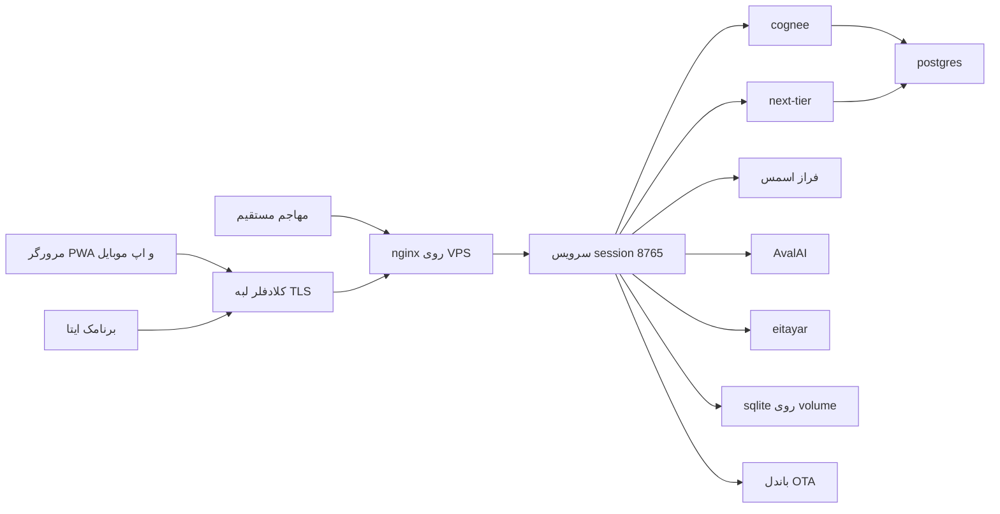

# بازبینی امنیتی ۲۰۲۶-۱۰-۳۰ — chat-with-books (ادامهٔ بازبینی ۲۰۲۶-۱۰-۲۴)

تاریخ: 2026-10-30 · شاخه: `2book-ingest` · بازبینی ایستا + probe زندهٔ محدود (DNS، دو درِ SSH) — بدون تست نفوذ
حوزه: **دلتا** — هرچه از بازبینی قبلی (`docs/security-review-2026-10-24.md`) تغییر کرد: درِ ورود با پیامک (OTP)، بازسازی سرور و مهاجرت به 193.93.169.153، قرارگرفتن پشت Cloudflare (2026-10-28)، سیاست کش جدید UI، APIهای مدیریتی تازه، چرخش توکن ایتا — به‌علاوهٔ راستی‌آزمایی وضعیت یافته‌های F-001..F-011.
آیدی‌ها ادامهٔ سری قبل‌اند: یافته‌های جدید F-012 به بعد، تهدیدهای جدید TM-009 به بعد.

---

## Executive summary

شش یافتهٔ بازبینی ۲۰۲۶-۱۰-۲۴ بسته شد و سر جایش ایستاد: محتوای کتاب‌ها احراز دارد، درهای ناشناس per-IP محدود شده‌اند، هدرهای امنیتی و کوکی `Secure` نشسته‌اند، و جریان OTP تازه (کد شش‌رقمی `secrets`، مقایسهٔ constant-time، قفلِ یکپارچه برای رقابت ارسال، پاسخ ۴۰۱ یکسان) از نظر کد تمیز است. **بزرگ‌ترین یافتهٔ این بازبینی در تعامل زیرساخت تازه با کنترل تازه است:** nginx مقدار `X-Real-IP` را با IP خودش بازنویسی می‌کند و از ۲۰۲۶-۱۰-۲۸ همهٔ ترافیک از Cloudflare می‌گذرد — پس بودجه‌های per-IP (۱۰ لاگینِ ناموفق، ۳۰ درخواست OTP در ۱۵ دقیقه) حالا **بین همهٔ کاربرانِ یک لبهٔ CF مشترک** است: قفل‌شدن جمعی کاربران و بستن ارزان ورود برای همه (F-012، high). بعد از آن: پذیرش گذرواژه در SSH و بازماندن درِ قدیمی ۲۲ (F-013)، و دسترس‌پذیری مستقیم origin که CF را لایه‌ای افزوده نگه می‌دارد نه دیوار (F-014). یافتهٔ بحرانی جدیدی (RCE، دورزدن احراز، افشای محتوا) یافت نشد.

**بستن نهایی (همین روز):** باقی‌ماندهٔ F-001..F-011 هم در همین روز بسته شد — F-001 و F-004 با اثبات زنده روی prod (۴۰۱ روی مسیرهای کتاب، هر چهار هدر)، F-006 با پذیرش ثبت‌شده (ADR-0024)، F-007 با پاک‌شدن فرگمنت مرده، F-008 با فیکس `+ os.sep` (۹۲۶ تست سبز)، F-010 با پینِ digest کانی، F-011 به‌عنوان پذیرفته‌شدهٔ ثبت‌شده. جدول پایین وضعیت نهایی را دارد؛ تیکت‌های F-001..F-011 روی ترکر هم با شواهد بسته شده‌اند.

## وضعیت یافته‌های بازبینی ۲۰۲۶-۱۰-۲۴

| قبلی | وضعیت | شاهد |
|---|---|---|
| F-001 کتابخانهٔ بدون auth | **بسته** ✓ | `resolve_identity` در هر چهار مسیر: `ui/serve.py:1521`، `1606`، `1764`، `1845` |
| F-002 لاگین بدون throttle | **بسته** ✓ (با ضعف F-012) | `ui/throttle.py:40` (۱۰ خطا/۱۵د)، اعمال در `ui/serve.py:2406-2412` |
| F-003 اوراکل شماره | **بسته** ✓ | سطل OTP هر تلاش را می‌شمارد (`throttle.py:11-14,41`؛ `serve.py:2507-2509`)؛ waitlist حذف شد (148ff8d) و درِ بازِ self-signup اوراکل را بی‌معنا کرد |
| F-004 هدرهای امنیتی | **بسته** ✓ | nosniff، Referrer-Policy، CSP، XFO در `serve.py:1258-1271` |
| F-005 کوکی بدون Secure | **بسته** ✓ | `Secure` شرطی بر `X-Forwarded-Proto` — `serve.py:1981-1995,2003-2006`؛ nginx همیشه روی ۴۴۳ می‌نشاند (`booksai.conf:61`) |
| F-006 PDF در تاریخچهٔ گیت | **بسته** ✓ (پذیرش ثبت‌شده) | ADR-0024 — `docs/adr/0024-accept-the-customer-pdf-in-git-history.md` |
| F-007 فرگمنت توکن ایتا | **بسته** ✓ | توکن چرخید (d1ef84a)؛ فرگمنت مرده از `ui/eitaa.py` و docs پاک شد (2026-10-30) |
| F-008 prefix بدون جداکننده | **بسته** ✓ | `+ os.sep` در هر دو گیت (lecture-audio و OTA)؛ ۹۲۶ تست سبز |
| F-009 سقف‌های OTP/waitlist | **بسته** ✓ | waitlist حذف؛ cooldown 120s + سقف روزی ۱۰ per-phone (`ui/otp.py:59-65`) + بودجهٔ per-IP |
| F-010 supply chain | **بسته** ✓ | کاگنی به digestِ اجراشده روی prod پین شد (هر دو سرویس)؛ npm build-time همان تعویق ثبت‌شده با دلیل |
| F-011 پذیرفته‌شده‌ها | **بسته** ✓ (پذیرفته‌شدهٔ ثبت‌شده) | طراحی‌شده‌اند؛ فهرست تازه در F-017 |

## مدل سیستم — تغییرات از بازبینی قبل



- **اینترنت → Cloudflare → nginx:** تازه. DNS امروز: `booksai.rayesh-team.ir` → 104.21.92.152 / 172.67.195.73 (رنج CF). در مرز CF→nginx **هویت کلاینت در `X-Real-IP` گم می‌شود** — مغز F-012. تنظیمات سمت CF (SSL mode، Min TLS، WAF) از ریپو قابل دیدن نیست → پرسش باز.
- **مهاجم → nginx مستقیم:** تازه‌نگهداری‌شده به‌عنوان واقعیت — origin روی IP خودش ۴۴۳/۸۰ را از هر منبعی می‌پذیرد (probe همین بازبینی).
- **ناشناس → `/auth/otp/request|verify`:** تازه. زنجیره: نرمال‌سازی سخت‌گیرانهٔ `09\d{9}` (`ui/accounts.py:286-294`) → بودجهٔ per-IP (۳۰/۱۵د) → cooldown 120s + سقف روزی ۱۰ per-phone، رزرو اتمیک زیر یک قفل (`ui/otp.py:95-128`، bbb4476) → ارسال الگوی فراز اسمس با کدِ `secrets.randbelow(1_000_000)` (`otp.py:222`). وریفای: بودجهٔ per-IP مستقل، ۴۰۱ یکسان برای غلط/منقضی/تمام‌شده، مقایسهٔ constant-time زیر قفل (`otp.py:153-171`)، سپس حسابِ موجود یا self-signup با ایمیل مصنوعی `<phone>@phone.local` و گذرواژهٔ تصادفی `token_urlsafe(18)` (`serve.py:705-715`).
- **ادمین → APIهای مدیریتی تازه:** کنسول و فرم‌هایش همان گیت `resolve_account + role==admin` را دارند (`serve.py:3596`، `3738-3745`؛ ساخت حساب `2586` با audit).
- **VPS تازه:** همهٔ سرویس‌ها همچنان روی 127.0.0.1 (`compose.production.yaml`؛ lecture-audio با mount فقط‌خواندنی). SSH روی ۶۰۴۱ (کلید) **و** ۲۲ — F-013.

## یافته‌های جدید

### F-012 · HIGH — بودجه‌های per-IP پشت Cloudflare تجمیع می‌شوند (قفل جمعی + بستن ارزان ورود)
- **شواهد:** `proxy_set_header X-Real-IP $remote_addr;` (`ops/nginx/booksai.conf:59`) — nginx هدرِ کلاینت را بازنویسی می‌کند؛ کلیدِ throttle همان X-Real-IP است (`ui/throttle.py:45-52` — docstringش فرض «هر کلاینت مستقیم، خودِ پروکسی است» را دارد که از ۲۰۲۶-۱۰-۲۸ دیگر برقرار نیست)؛ DNS = رنج CF؛ کامیت af9b176 تاریخ روشن‌شدن را ثبت کرده.
- **اثر:** `$remote_addr` از دید nginx حالا IP لبهٔ CF است، نه کاربر. سطل «۱۰ لاگینِ ناموفق/۱۵د» و «۳۰ درخواست OTP/۱۵د» بین **همهٔ کاربرانِ یک لبه** مشترک می‌شود: (۱) ده خطای تایپِ جمعی → ۴۲۹ برای همهٔ آن لبه تا ۱۵ دقیقه؛ (۲) مهاجم با ۱۰ رمزِ غلط عمدی (یا ۳۰ درخواست OTP) ورودِ یک لبهٔ کامل را می‌بندد و هر ۱۵ دقیقه تمدید می‌کند — ارزان‌ترین DoS ممکن روی درِ ورود؛ خودش هم در سطل مشترک گم است. **آنچه خطر نیست:** جعل هدر — nginx بازنویسی می‌کند و مهاجمِ مستقیم هم IP واقعی خودش را می‌گیرد؛ مشکل صرفاً تجمیع است.
- **توصیه (ملموس، چند خط):** ماژول real_ip در nginx، اعتماد فقط به CF:
  ```nginx
  # رنج‌های کامل از https://www.cloudflare.com/ips — در استقرار fetch/به‌روز شوند
  set_real_ip_from 173.245.48.0/20;
  # … باقی رنج‌های CF
  real_ip_header CF-Connecting-IP;
  real_ip_recursive off;
  ```
  با این، `$remote_addr` برای ترافیک CF می‌شود IP واقعی کاربر و `X-Real-IP` همان را حمل می‌کند؛ `CF-Connecting-IP` جعلی از منبعِ غیر-CF اعتماد نمی‌شود و مهاجم مستقیم IP خودش را می‌مانَد. مکمل: قواعد Rate Limiting خود CF روی `/auth/*`. تا پیش از فیکس، سقف‌ها را هم موقتاً می‌توان بالاتر برد تا قفل جمعی کمتر شود — به بهای شل‌شدن حدس‌گیری.

### F-013 · MEDIUM — SSH: پذیرش گذرواژه فعال است و درِ قدیمی (۲۲) هنوز باز
- **شواهد (probe زندهٔ امروز):** پورت ۶۰۴۱ → `Permission denied (publickey,password)`؛ پورت ۲۲ → TCP باز (ورک‌فلوی probe عمداً هر دو را می‌آزماید، 105497a).
- **اثر:** دو درِ عمومی برای سروری که کلید دیپلویش معادل root است (audio-intake با `--privileged --pid=host`)؛ brute-force گذرواژه روی ۶۰۴۱ ممکن.
- **توصیه:** در `sshd_config`: `PasswordAuthentication no` و `PermitRootLogin prohibit-password`؛ سپس بستن ۲۲. قانون «درِ تازه را از بیرون تأیید کن، بعد قدیمی را ببند» برآورده است — probe CI از بیرون ۶۰۴۱ را سبز می‌بیند؛ فقط بعد از بستن، یک اجرای probe را نگاه کنید که شاخهٔ ۲۲ خالی مانعش نشود.

### F-014 · MEDIUM-LOW — Cloudflare لایهٔ افزوده است، نه دیوار؛ origin مستقیم در دسترس است
- **شواهد:** اتصال مستقیم به origin روی ۴۴۳/۸۰ در همین بازبینی پاسخ داد؛ IP در لاگ‌های workflow با hex/base64 پوشانده می‌شود ولی از قبل عمومی بوده؛ nginx هیچ قیدی روی منبع ندارد.
- **اثر:** هر قاعدهٔ CF (WAF، rate limit، bot fight) با اتصال مستقیم دور زده می‌شود؛ سطح حربهٔ خالص همان قبل است.
- **توصیه (با احتیاط):** پنل CF: SSL mode «Full (strict)» (cert اصلی LE معتبر است)، Minimum TLS 1.2. اختیاری بعدی: محدودکردن ۴۴۳ به رنج‌های CF — و **۸۰ برای ACME باز بماند**؛ location `/.well-known/acme-challenge/` روی هر دو face (diff کامیت‌نشدهٔ `booksai.conf`) همین را درست پیش می‌رود — کامیت و استقرارش فراموش نشود تا conf باکس با ریپو یکی بماند.

### F-015 · LOW — CSP با `'unsafe-inline'` (پذیرفته‌شده، ثبت شد)
- **شواهد:** `serve.py:1233-1244` — کامنت خودش دلیلش را ثبت کرده (صفحات تک‌فایلی با اسکریپت/استایل inline، بدون اسکریپت ثالث).
- **باقیمانده:** دفاع دوم در برابر XSS آینده محدود می‌ماند. نوبت بعدی: nonce. فوریت ندارد.

### F-016 · LOW — باقی‌مانده‌های supply chain و بهداشت
- تگ شناور `cognee/cognee:main` (`compose.yaml:24,93`) — **بسته شد در همان روز:** هر دو سرویس به digestِ اجراشده روی prod پین شدند (`sha256:61a1af76…`)؛ ارتقای پلتفرم از این پس یک re-pin آگاهانه است.
- npm build-time highs — همان تعویق ثبت‌شدهٔ F-010.
- فرگمنت توکنِ مردهٔ ایتا (`$iDmYpyQ`) در `ui/eitaa.py:41` و `docs/eita-miniapp-zero-to-hundred.md:46` — **بسته شد در همان روز:** فرگمنت از هر دو پاک شد؛ دلیل `$`-داربودن توکن در متن مانده است.
- **سالم:** `mobile/*.apk` gitignored و `cwb-release.apk` هرگز کامیت نشده؛ از ۲۴ اکتبر هیچ سیکرت تازه‌ای به history راه نیافته (توکن ایتا فقط از GH secret می‌آید؛ docsهای تازه فقط کلید عمومی SSH دارند).

### F-017 · INFO — پذیرفته‌شده‌های جدید این بازبینی
- کدهای OTP فقط حافظه‌اند — restart کدهای pending را می‌ریزد (کاربر دوباره کد می‌خواهد)؛ هیچ کدی روی دیسک نمی‌نشیند.
- self-signup با شمارهٔ تأییدشده — قانون PM (ADR-0017)؛ قیدش cooldown 120s + روزی ۱۰ per-phone + ۳۰/۱۵د per-IP (با ابهام F-012 در بعد per-IP).
- کش عمومی یک‌سالهٔ باندل OTA (`serve.py:2333`) — طراحی‌شده؛ JSON و manifest از آن مستثنا (`_CACHEABLE_SUFFIXES`، `serve.py:1197-1200` — `.json` در خانوادهٔ کش نیست).
- `DISABLE_LOGIN` فقط opt-in است (`== "1"`، `serve.py:797-802`؛ compose پیش‌فرض 0) و سرور dev (`ui/mobile-server.mjs`) در ایمیج production کپی نمی‌شود (لیست صریح `ui/Dockerfile:23`).

## جدول تهدیدهای جدید

| ID | تهدید | پیش‌نیاز | کنترل موجود (شاهد) | شکاف | توصیه | اثر | احتمال | اولویت |
|---|---|---|---|---|---|---|---|---|
| TM-009 | تجمیع سطل throttle پشت CF → قفل جمعی و DoS ورود | اینترنت از CF | throttle در خود serve.py (`throttle.py`)؛ nginx هدر را بازنویسی می‌کند | `X-Real-IP = $remote_addr` (`booksai.conf:59`) | real_ip با `CF-Connecting-IP` (F-012) | ورودِ همهٔ یک لبه می‌بندد | بالا | **high** |
| TM-010 | brute-force SSH | اینترنت به VPS | کلید دیپلوی؛ probe دو در را می‌آزماید | پذیرش password؛ درِ ۲۲ باز | `PasswordAuthentication no` + بستن ۲۲ (F-013) | معادل root اگر گذرواژه شکست | متوسط | **medium** |
| TM-011 | دورزدن CF با اتصال مستقیم به origin | دانستن IP | TLS + cert سالم؛ همهٔ کنترل‌های L7 در serve.py هستند | هیچ قیدی روی منبع ۴۴۳ | پنل CF: Full(strict)، Min TLS؛ بعداً رنج‌ها (F-014) | بی‌اثرکردن قواعد CF | متوسط | **medium** |

## مسیرهای سوءاستفاده (جدید)

1. **بستن ورود یک لبه:** ۱۰ POST رمز غلط به `/auth/login` → سطل لبه پر → همهٔ کاربران پشت آن لبهٔ CF تا ۱۵ دقیقه ۴۲۹ (TM-009/F-012).
2. **brute-force SSH:** حلقهٔ گذرواژه روی ۶۰۴۱ از هر نقطهٔ اینترنت (TM-010).
3. **گریز از CF:** اتصال مستقیم به origin برای عبور از هر قاعدهٔ لبه‌ای (TM-011).

## پرسش‌های باز

1. `AUTH_SECRET` روی VPS تازه pin شده؟ (runbook بازسازی به آن اشاره ندارد؛ اگر pin نباشد هر restart همهٔ نشست‌ها را بیرون می‌اندازد.)
2. تنظیمات پنل CF: SSL mode، Minimum TLS، WAF/rate limit — از ریپو قابل راستی‌آزمایی نیست.
3. آیا شکل CF دائمی است؟ (راه‌حل F-012 در هر دو حالت درست است ولی اولویتش به این وابسته است.)
4. ~~تصمیم F-006~~ — **حل شد:** پذیرش ثبت‌شده در ADR-0024 (2026-10-30).
5. پورت ۲۲ کی بسته شود؟ پیشنهاد: بعد از `PasswordAuthentication no` و یک اجرای سبزِ probe.

## مسیرهای کانونی برای بازبینی بعدی

| مسیر | چرا | تهدید |
|---|---|---|
| `ops/nginx/booksai.conf` | فیکس real_ip + diff کامیت‌نشدهٔ ACME | TM-009/011 |
| `ui/throttle.py` + بخش auth `ui/serve.py:2390-2600` | کلید و بودجه‌ها؛ اگر روزی چندپروسسه شد، استور مشترک لازم است | TM-009 |
| sshd روی VPS | PasswordAuthentication / بستن ۲۲ | TM-010 |
| `compose.yaml:24,93` | پین‌کردن تصویر کاگنی | F-016 |

## Checklist کیفیت

- همهٔ entry pointهای تازه (دو درِ OTP، APIهای ادمین، ACME روی ۴۴۳، `/eitaa` بعد از چرخش توکن) پوشش داده شدند.
- هر مرز تازه (CF→nginx، مهاجم→origin مستقیم، SSH) حداقل در یک تهدید آمد.
- runtime در برابر CI/بیلد جدا ماند: workflowهای تازه فقط probe و رمزگذاری لاگ‌اند.
- راستی‌آزمایی یافته‌های قبلی: ۶ بسته، ۲ باز (F-006، F-008)، ۱ نیمه‌باز (F-010)، ۱ جانشین‌شده (F-007).
- فرض‌ها و پرسش‌های باز صریح‌اند؛ probeهای زنده فقط DNS و TCP/SSH handshake بودند — بدون تست نفوذ.
