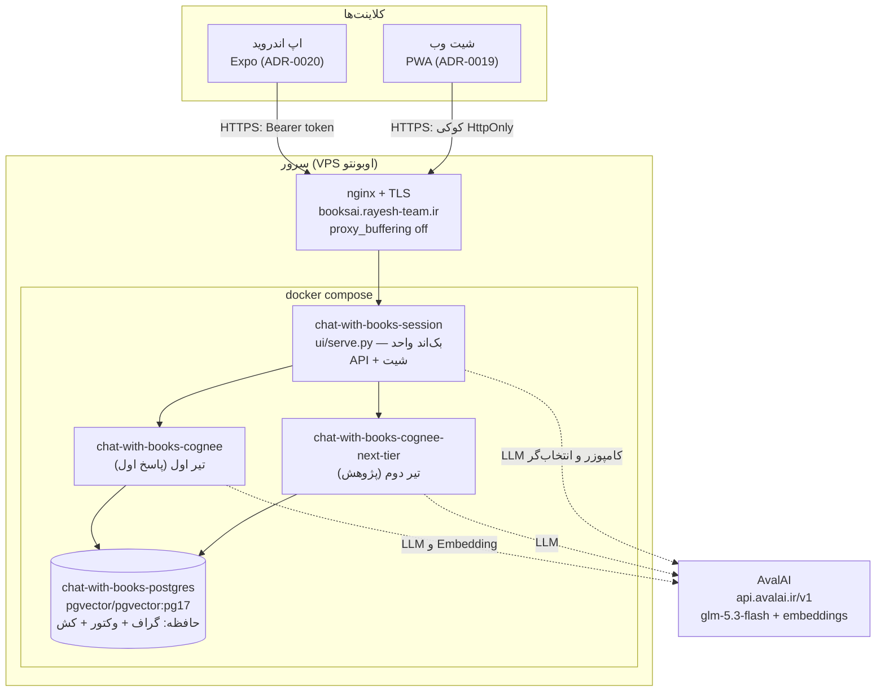
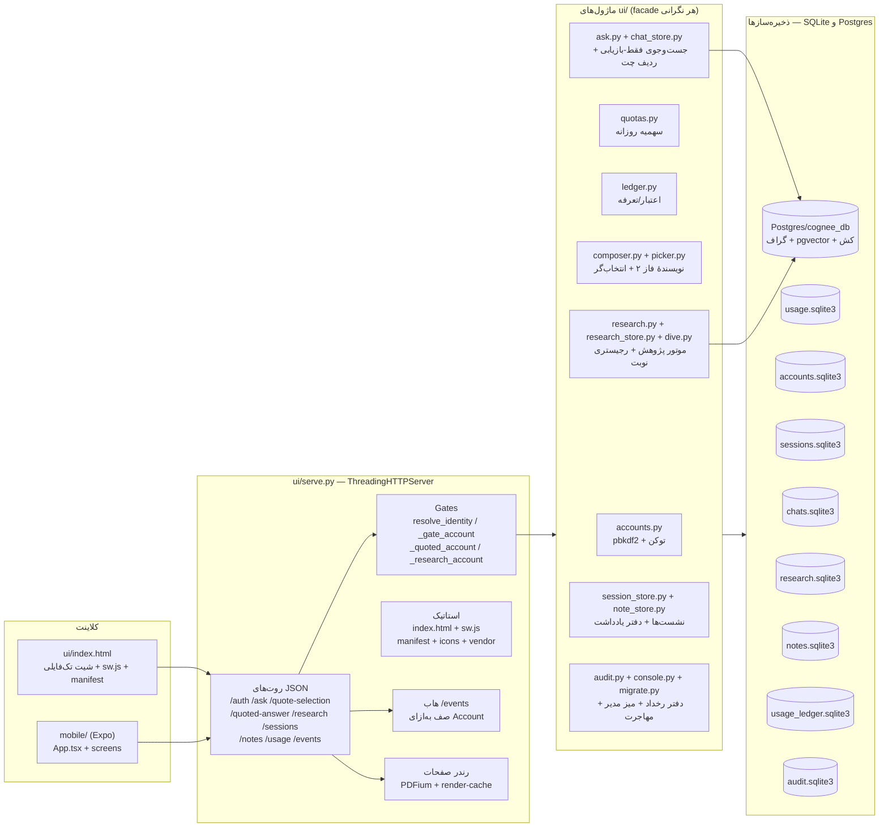
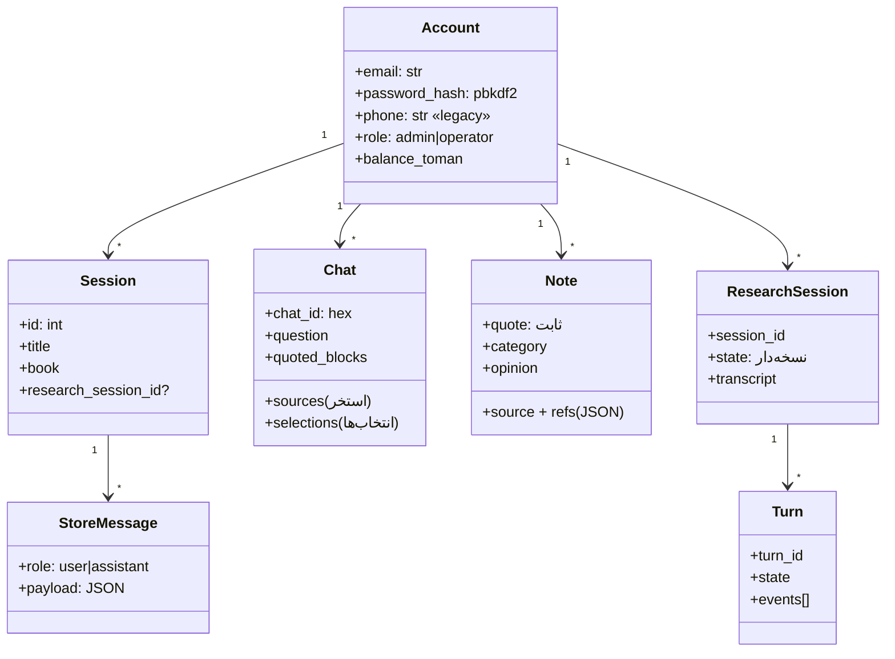
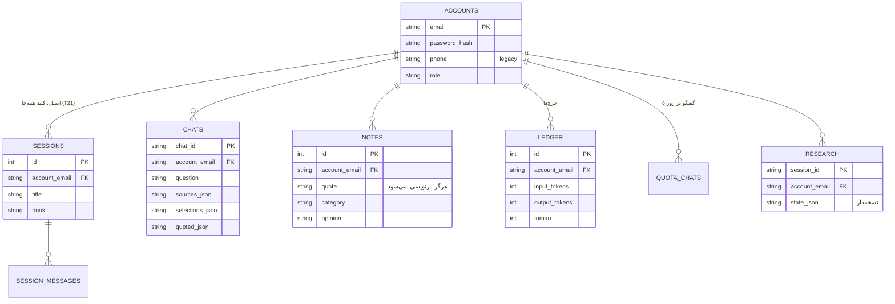
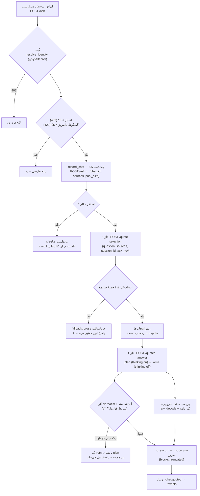
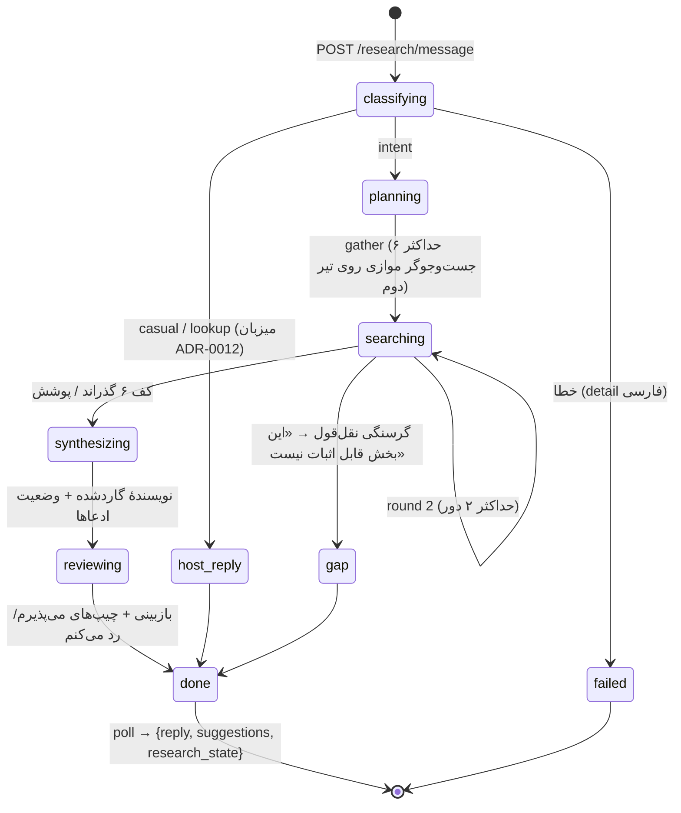
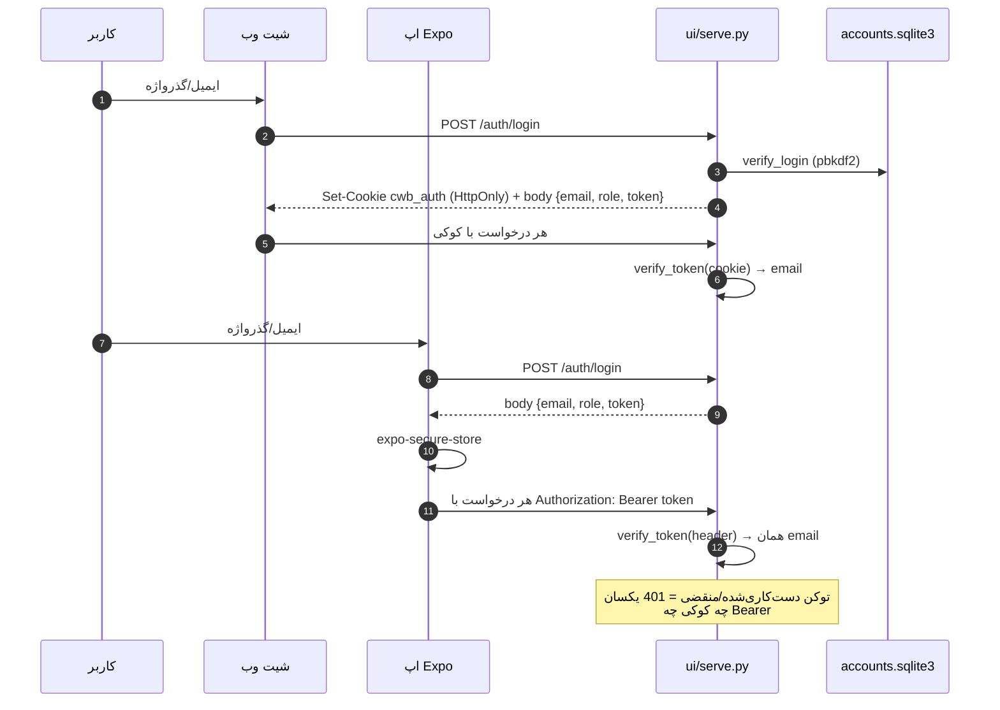
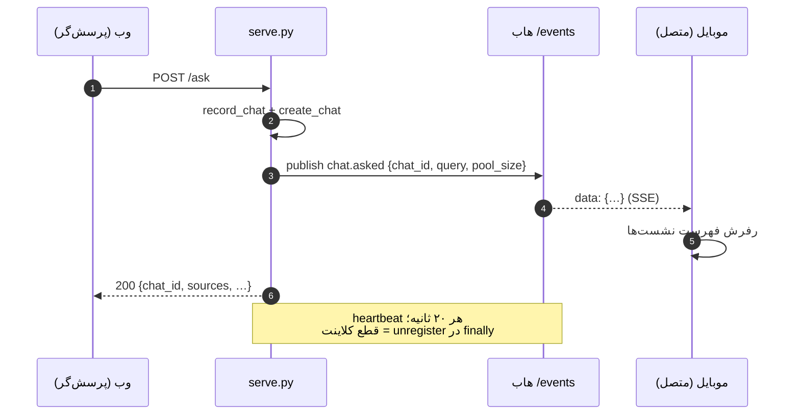
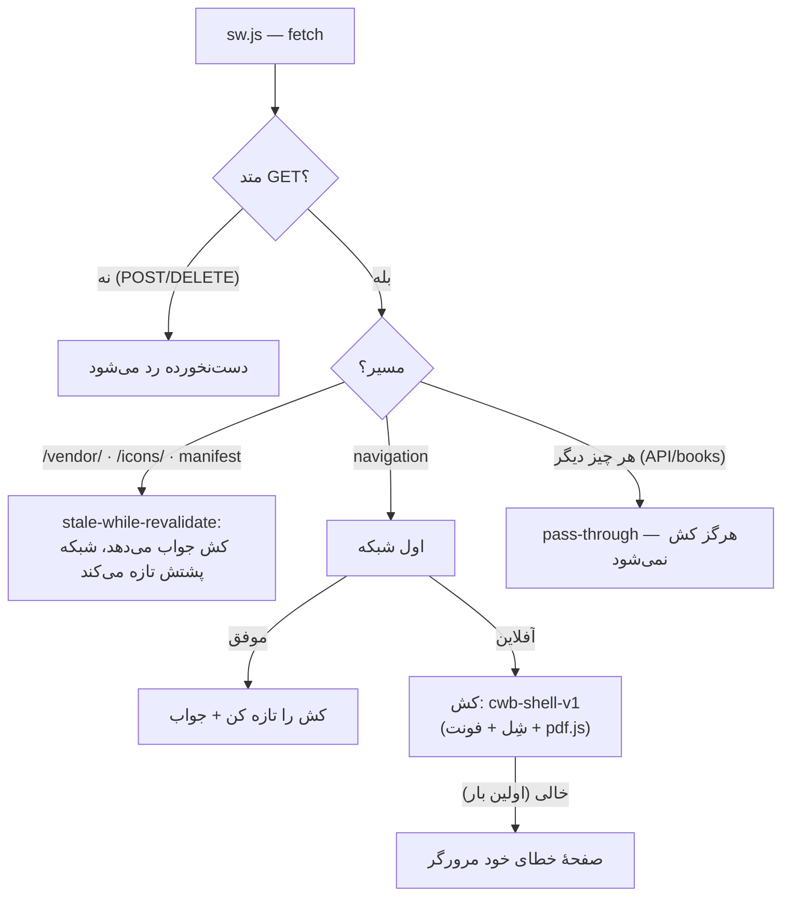
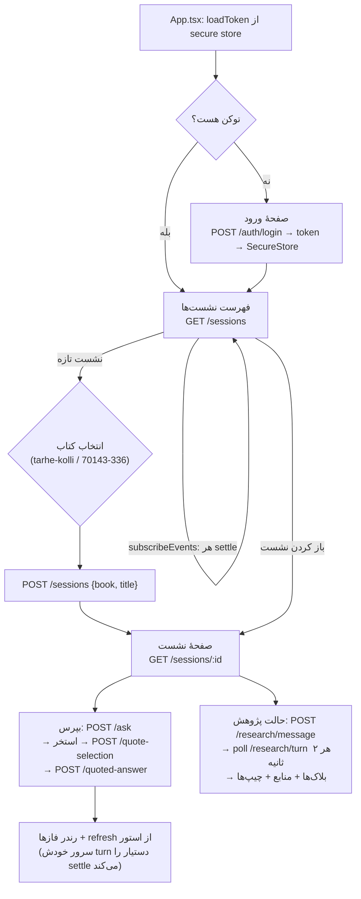

# نشست — صفر تا صد

> سند جامع محصول: معماری، جریان‌ها، UML و فلوچارت‌ها، دیتا، و راه‌اندازی از صفر.
> نمودارها Mermaid هستند و توی GitLab/GitHub مستقیم رندر می‌شن.
> مرجع‌های رکورد‌شده: `README.md`، `docs/CONTEXT.md`، `docs/adr/0001…0020`.

---

## فهرست

1. [نمای کلی](#۱-نمای-کلی)
2. [معماری و استقرار](#۲-معماری-و-استقرار)
3. [ساختار کد (UML ساختاری)](#۳-ساختار-کد-uml-ساختاری)
4. [دیتا و مخازن (ERD)](#۴-دیتا-و-مخازن-erd)
5. [جریان خط اول پاسخ (فلوچارت)](#۵-جریان-خط-اول-پاسخ)
6. [جریان حالت پژوهش (State Machine)](#۶-جریان-حالت-پژوهش)
7. [احراز هویت: کوکی وب، Bearer موبایل (Sequence)](#۷-احراز-هویت)
8. [Real-Time: خط زنده‌ی /events (Sequence)](#۸-real-time-خط-زنده)
9. [PWA: نصب و آفلاین (فلوچارت Service Worker)](#۹-pwa-نصب-و-آفلاین)
10. [اپ موبایل Expo (فلوچارت)](#۱۰-اپ-موبایل-expo)
11. [قرارداد API](#۱۱-قرارداد-api)
12. [راه‌اندازی صفر تا صد](#۱۲-راه‌اندازی-صفر-تا-صد)
13. [تست‌ها و قفل‌ها](#۱۳-تست‌ها-و-قفل‌ها)
14. [بکاپ و بازگردانی](#۱۴-بکاپ-و-بازگردانی)

---

## ۱. نمای کلی

**نشست** یک محصول فارسیِ پرسش‌وپاسخ استنادی از روی مجموعه‌ی ثابتی از کتاب‌هاست (دو کتاب: «طرح کلی اندیشۀ اسلامی در قرآن» و «انسان ۲۵۰ ساله») که لایه‌ی حافظه‌اش کامل روی Postgres/pgvector از طریق Cognee ساخته می‌شود.

- **یک بک‌اند** (`ui/serve.py` — فقط کتابخانۀ استاندارد پایتون) که هم شیت وب را سرو می‌کند و هم **API مشترک** وب و موبایل است؛ روی سرور (VPS) پشت `https://booksai.rayesh-team.ir` می‌نشیند.
- **دو کلاینت**: شیت وب (تک‌فایل `ui/index.html` + PWA) و اپ اندروید (`mobile/` — Expo + TypeScript). هر دو دقیقاً یک قرارداد سیمی را حرف می‌زنند. (سومین کلاینت، **برنامک ایتا** — ADR-0021 — همان قرارداد را از WebView ایتا با توکنِ عوض‌شده از initData حرف می‌زند.)
- **سه فاز برای یک پرسش** (ADR-0014): «پاسخ اول» (انتخاب نقل‌قول از استخر بازیابی)، «پاسخ استنادی» (سند تلفیقی با نقل‌قول‌های verbatim)، و «حالت پژوهش» (گفت‌وگوی پژوهشی هدایت‌شده با نقشه و سکوی تصمیم).
- **مدل‌ها**: `glm-5.3-flash` از طریق AvalAI (چت، استخراج، امبدینگ `text-embedding-3-large`/3072).
- **حساب‌ها (Account)** به‌جای گیت شماره‌ی تلفن (ADR-0013): ورود با ایمیل/گذرواژه، سهمیه‌ی روزانه‌ی گفت‌وگو، اعتبار (Balance) پیش‌پرداخت، دفتر مدیر (میز مدیریت) و گزارش رخداد.
- **Real-Time** (ADR-0020): خط زنده‌ی SSE (`/events`) که settleهای سمت سرور را همان لحظه به همه‌ی کلاینت‌های آن Account می‌رساند.

---

## ۲. معماری و استقرار

### نمودار استقرار (Deployment)



### پورت‌ها

| سرویس | لوکال (dev) | VPS |
|---|---|---|
| شیت / API | `127.0.0.1:8765` (پروسه‌ی میزبان یا کانتینر session) | `127.0.0.1:8765` پشت nginx (TLS) |
| Cognee تیر اول | `localhost:18000` (ریمپ ضبط‌شده) | `127.0.0.1:8000` |
| Cognee تیر دوم | `localhost:8001` | `127.0.0.1:8001` |
| Postgres | `127.0.0.1:55433` (override محلی؛ ۵۴۳۲ ماشین، مال PG18 نیتیو است) | فقط داخل شبکه‌ی compose |

### محیط‌های اجرای شیت

1. **پروسه‌ی میزبان** (مسیر dev): `start-ui.ps1` / `.scratch/start-sheet.ps1` → `python ui/serve.py`
2. **کانتینر** (پروفایل `session`): `docker compose --profile session up -d --build` — ایمیج stdlib-only از `ui/Dockerfile`

---

## ۳. ساختار کد (UML ساختاری)

### نمودار کامپوننت



### روابط کلیدی (Class-diagram گونه)



---

## ۴. دیتا و مخازن (ERD)

لایۀ حافظه در Postgres است (گراف `postgres_demo`، وکتور `pgvector`، کش) و هر نگرانی محصول، فایل SQLite خودش را دارد — «یک پچ، یک فایل».



| فایل (env) | محتوا |
|---|---|
| `SESSION_UI_QUOTA_DB` → `usage.sqlite3` | سهمیه‌ی گفتگوهای روزانه + نشست‌های قبلی |
| `ACCOUNTS_DB` → `accounts.sqlite3` | حساب‌ها (pbkdf2 240k) |
| `SESSIONS_DB` → `sessions.sqlite3` | نشست‌ها و پیام‌ها (T27) |
| `SESSION_CHAT_DB` → `chats.sqlite3` | ردیف چت هر پرسش (ADR-0014) |
| `SESSION_RESEARCH_DB` → `research.sqlite3` | نشست‌های پژوهش |
| `NOTES_DB` → `notes.sqlite3` | دفتر یادداشت |
| `LEDGER_DB` → `usage_ledger.sqlite3` | دفتر خرج (تعرفه از env) |
| `AUDIT_DB` → `audit.sqlite3` | دفتر رخداد مدیر (append-only) |
| Postgres `cognee_db` | گراف + وکتور + کش Cognee (لایه‌ی حافظه) |

---

## ۵. جریان خط اول پاسخ

یک پرسش، هر سه فاز را می‌سازد (ADR-0014). فاز ۱ فقط بازیابی است — هیچ LLMی در مسیر استخر نیست؛ انتخاب‌گر یک فراخوانِ کپی‌سازی است؛ نویسنده‌ی فاز ۲ با plan + write و گارد verbatim.



نکته‌های ضبط‌شده: هر بند فاز ۲ باید هم متن AI و هم حداقل یک نقل‌قول سالم داشته باشد؛ صفحه‌ی واقعی هر نقل‌قول با `page_resolver` از لایۀ متن کتابResolve می‌شود (ADR-0011)؛ «جست‌وجوی بیشتر» (`/recall-more`) استخر را با حداکثر دو کوئری facet گسترش می‌دهد و فاز ۲ را روی استخر ادغام‌شده دوباره می‌نویسد.

---

## ۶. جریان حالت پژوهش

هر پیام یک «نوبت» است: کار در رجیستری درون-پروسس (حداکثر ۱ نوبت هم‌زمان برای هر Account، ۳ سراسری)، کلاینت `202 {turn_id, session_id}` می‌گیرد و `/research/turn` را poll می‌کند. ماشین وضعیت فقط با کد جلو می‌رود؛ مدل فقط محتوا پیشنهاد می‌دهد (ADR-0009).



ایمنی‌ها: تغییر پرسش/دامنه هرگز خودِ خود اعمال نمی‌شود — پیشنهادِ در انتظار + «می‌پذیرم/رد می‌کنم»؛ سقف‌های ledger (T12)؛ نقشه‌بان (پاک‌سازی با تصمیم)؛ کاوشگرِ مه (T13)؛ گزارش نشست (`/research/report`) وقتی Brief هست.

---

## ۷. احراز هویت

یک در (`/auth/login`)، یک توکن امضاشده (HMAC-SHA256، payload+signature، انقضا داخل payload)، دو مُهر: کوکی HttpOnly برای وب، `Authorization: Bearer` برای موبایل (ADR-0013 + ADR-0020). بدون `AUTH_SECRET`، سرور per-process می‌سازد و فارسی هشدار می‌دهد.



گیت‌ها: `_gate_account` (پرسش: اعتبار + سهمیه + ثبت چت)، `_quoted_account` (فاز ۲: حداقل یک چت امروز، بدون شمارش)، `_research_account` (فاز ۳: فقط اعتبار).

---

## ۸. Real-Time: خط زنده

Settleهای سمت سرور یک رویداد به صف‌های آن Account تزریق می‌کنند؛ هر کلاینت متصل (وبِ بعدی، موبایل) همان لحظه می‌فهمد (ADR-0020). استریم «زنگ» است، نه «سابقه» — حقیقت در SQLite است.



رویدادها: `chat.asked` · `chat.selected` · `chat.quoted` · `chat.widened` · `research.started` · `note.saved`. تکمیل نوبتِ پژوهش همچنان از poll ضبط‌شده‌ی `/research/turn` می‌آید.

---

## ۹. PWA: نصب و آفلاین

قرارداد تازگی ۲۰۲۶-۰۹-۱۱ حفظ می‌شود: ناوبری **network-first** است — نسخه‌ی کش فقط جوابِ آفلاین است، هرگز صفحۀ دیپلویِ عقب‌افتاده (ADR-0019).



نصب: چیپ «نصب برنامه» فقط وقتی Chromium واقعاً بتواند (`beforeinstallprompt`)؛ iOS از share sheet سافاری. تایپ‌های استاتیک در `serve.py` pin شده‌اند (رجیستری ویندوز نباید بین شیت و نصب باشد)؛ آیکون‌ها از سورس با `py tools/make_pwa_icons.py`.

---

## ۱۰. اپ موبایل Expo

یک استک، سه صفحه؛ قرارداد سیمی = دقیقاً همان شیت (تست متقاطع این را قفل می‌کند).



URL پایه با `EXPO_PUBLIC_API_URL` (پیش‌فرض: `https://booksai.rayesh-team.ir`؛ امولاتور: `http://10.0.2.2:8765`). استرینگ‌ها DRAFT در `src/strings.ts`؛ پالت در `src/theme.ts`.

#### آپدیت‌ها: OTA، نه APK (قانون ۰۰۱)

از ۲۰۲۶-۱۰-۰۳ هیچ APK جدیدی ساخته نمی‌شود ([`docs/rules/001-no-new-apks.md`](rules/001-no-new-apks.md)):
هر تغییر موبایل با `expo export` + `py scripts/publish_ota.py` به `ui/ota/` منتشر می‌شود؛
بک‌اند همان یک سرویس، مانیفست را روی `GET /ota` (۲۰۴ = به‌روزه) و فایل‌ها را immutable روی
`/ota/current/*` می‌دهد. اپ در هر اجرای تازه (`checkAutomatically: ON_LOAD`) بی‌سروصدا
دانلود می‌کند و در اجرای بعدی تازه می‌شود — کاربر هیچ کاری نمی‌کند. تنها استثنا: تغییر
نیتیو، و آن هم فقط با تأیید کتبی مدیر محصول.

---

## ۱۱. قرارداد API

همه‌ی بدنه‌ها JSON؛ خطاها `{detail: "فارسی"}`. گیت = 401 (بدون/بد توکن)، 402 (اعتبار)، 429 (سهمیه/شلوغی).

| مسیر | متد | گیت | بدنه → پاسخ |
|---|---|---|---|
| `/auth/login` | POST | — | `{email,password}` → `{email,role,token}` + کوکی |
| `/auth/me` · `/auth/logout` | GET · POST | باز برای رسیدن | whoami / پاک‌کردن کوکی |
| `/auth/accounts` | POST | admin | صدور Account |
| `/sessions` | GET · POST | Account | فهرست / `{book,title}` → `{id,…}` |
| `/sessions/:id` | GET · DELETE | مالک | نشست + پیام‌ها (با `research_session_id`) |
| `/sessions/:id/messages` | POST | مالک | `{role,payload}` |
| `/ask` | POST | `_gate_account` | `{query, datasets?}` → `{chat_id, sources, pool_size}` |
| `/quote-selection` | POST | `_quoted_account` | `{question, sources, session_id?, ask_key?, chat_id?}` → `{selections, pool_size}` |
| `/quoted-answer` | POST | `_quoted_account` | همان + `answer?` → `{blocks, truncated}` |
| `/recall-more` | POST | `_quoted_account` | `{question, sources, datasets?, chat_id?}` → `{sources: fresh}` |
| `/evidence-fallback` | POST | `_quoted_account` | جست‌وجوی یک‌باره برای استخر |
| `/research/message` | POST | `_research_account` | `{message, …}` → `202 {turn_id, session_id}` |
| `/research/turn?turn=` | GET | مالک نوبت | `{state, events, elapsed}` → done/failed |
| `/research/state · /messages · /decide · /report` | GET/POST | مالک نشست | نقشه، ترنسکریپت، تصمیم، گزارش |
| `/notes` · `/notes/:id` · `/notes/bulk-delete` | CRUD | مالک | دفتر یادداشت |
| `/usage/live` | GET | Account | هزینه‌ی زنده از ledger |
| `/chat/latest` | GET | Account | آخرین ردیف چت (بازیابی بعد از reload) |
| `/events` | GET | Account | **SSE** — خط زنده |
| `/eitaa` | GET | — | صفحۀ **برنامک ایتا** (WebView؛ اعتبار = initData، نه URL) |
| `/eitaa/auth` | POST | امضای initData | `{initData}` → `{bound, token?, email?, role?, user}` (۱=تبادل، ۰=درِ ورود) |
| `/eitaa/link` | POST | امضای initData + گذرواژه | `{initData,email,password}` → توکن + ثبت اتصال (یک در، یک‌بار) |
| `/eitaa/unlink` | POST | Account + امضای initData | حذف اتصال خودِ تماس‌گیرنده → `{deleted}` |
| `/books/:d/book · page/:n.png · …` | GET | — | PDF و رستر صفحات (ETag/immutable) |
| `/health` (پروکسی) · `/livez` | GET | — | سلامت |
| `/admin` · `/admin/*` | GET/POST | admin | میز مدیر: صدور، شارژ، پیوند، رخداد |

اشتراک‌گذاری منابع (CORS) فقط برای Originهای allowlist (`SESSION_UI_ALLOWED_ORIGINS`)؛ native نیازی ندارد.

---

## ۱۲. راه‌اندازی صفر تا صد

### الف) استک سرویس (لوکال ویندوز)

```powershell
# ۱) کلیدها: .env کنار compose (LLM_API_KEY و EMBEDDING_API_KEY هر دو AvalAI؛
#    AUTH_SECRET، ADMIN_EMAIL/ADMIN_PASSWORD هم اینجا)
copy .env.example .env

# ۲) پورت 5432 ماشین اشغال است (PG18 نیتیو) → override محلی:
#    compose.override.yaml: postgres → "55433:5432"  (gitignore شده)

# ۳) بالاکشیدن
docker compose up -d postgres
#    (ایمیج‌ها اگر Docker Hub در دسترس نبود، از VPS:
#     ssh mhmdrz 'docker save  | gzip -1' | docker load)

# ۴) بازگرداندن حافظه (اگر دیتای ingest هست — وگرنه ingest: § «Book ingest» README)
docker cp cognee_db.dump chat-with-books-postgres:/tmp/
docker exec chat-with-books-postgres pg_restore -U cognee -d cognee_db --clean --if-exists /tmp/cognee_db.dump

# ۵) تیرها
docker compose up -d cognee cognee-next-tier   # منتظر healthy بمان

# ۶) شیت (پروسه‌ی میزبان)
powershell -ExecutionPolicy Bypass -File .scratch/start-sheet.ps1
#    = LLM_* + AUTH_SECRET + ADMIN_* از .env +
#      COGNEE_URL=http://127.0.0.1:18000  NEXT_TIER_URL=http://127.0.0.1:8001
#      NO_PROXY=127.0.0.1,localhost   ← پروکسی سیستمی نباید 127.0.0.1 را بقاپد

# ۷) وریفای (بدون خرج LLM)
py scripts/smoke.py --cognee-url http://localhost:18000
```

نخستین Admin از `ADMIN_EMAIL/ADMIN_PASSWORD` در استارت کاشته می‌شود. ورود: `http://localhost:8765`.

### ب) اینجست کتاب‌ها (فقط بار اول، بدون بکاپ)

```powershell
curl.exe -f -X POST http://localhost:18000/api/v1/remember -F "data=@books/tarhe-kolli.pdf" -F "datasetName=tarhe-kolli" -F "run_in_background=true" -F "chunk_size=4100" -F "chunks_per_batch=36"
curl.exe -f -X POST http://localhost:18000/api/v1/remember -F "data=@books/70143-336.pdf" -F "datasetName=70143-336" -F "run_in_background=true" -F "chunk_size=3500" -F "chunks_per_batch=36"
curl.exe -sS http://localhost:18000/api/v1/datasets/status   # تا DATASET_PROCESSING_COMPLETED
```

### ج) اپ موبایل

```bash
cd mobile
npm install
EXPO_PUBLIC_API_URL=http://10.0.2.2:8765 npx expo start   # امولاتور → host
# یا dev build روی گوشی/امولاتور:
npx expo run:android
npx tsc --noEmit                                          # وریفای تایپ‌ها
```

### د) VPS

`tarball swap` به `/home/ubuntu/chat-with-books` (PDFها و render-cache و `.env` و استورها از درخت قبلی منتقل می‌شوند) → `docker compose -p chat-withbooks up -d` → nginx روی `booksai.rayesh-team.ir` (TLS + `proxy_buffering off` + تایم‌اوت ≥ 1200s). اپ موبایل به همین دامنه وصل می‌شود — بک‌اندِ یکی است.

---

## ۱۳. تست‌ها و قفل‌ها

```powershell
$env:PYTEST_DISABLE_PLUGIN_AUTOLOAD = "1"
python -m pytest        # ~600 تست، ~33 ثانیه؛ گیتِ push (T16): قرمز = push نمی‌شود
```

- **قراردادها به‌صورت doc test قفل‌اند**: ingest، پاسخ اول، سلامت، compose، PWA (`test_pwa_docs.py`)، API موبایل (`test_mobile_api.py`: Bearer، CORS، SSE، تطابق مسیرهای `api.ts` با روت‌های `serve.py`)، و بقیه.
- **smoke استقرار**: `py scripts/smoke.py --cognee-url …` — livez، health، و یک سرچ واقعی CHUNKS (بدون خرج).
- تست‌ها روی این ماشین باید در `.venv` و با `NO_PROXY=127.0.0.1,localhost` اجرا شوند (پکیج سرگردان `tests` در site-packages سراسری + پروکسی سیستمی).

---

## ۱۴. بکاپ و بازگردانی

- **شبانه (VPS)**: `scripts/backup.sh` (cron 03:30) — `cognee_db.dump` + SQLiteها + `.env` + PDFها + zip کد؛ ۱۴ نسخه روی VPS، ۳۰ نسخه با `scripts/pull_backup.ps1` روی ماشین اپراتور.
- **بازگردانی**: `scripts/restore.sh` + `docs/restore-drill.md` — تمرین در یک Postgres دورریز (پورت 5433): `pg_restore -U cognee -d cognee_db --clean --if-exists` (در Git Bash با `MSYS_NO_PATHCONV=1`).
- **توجه**: تغییر مدل/ابعاد امبدینگ = باطل‌شدن همه‌ی وکتورها → اینجست کامل (ADR-0004). گارد `check_embedding_pin` در شیت اجابت را فارسی کرش می‌کند، نه سبزِ خراب.

---

*این سند با ADR-0001…0020 و README هم‌راستاست؛ هر تغییر قرارداد، اول ADR، بعد تست، بعد این سند.*
